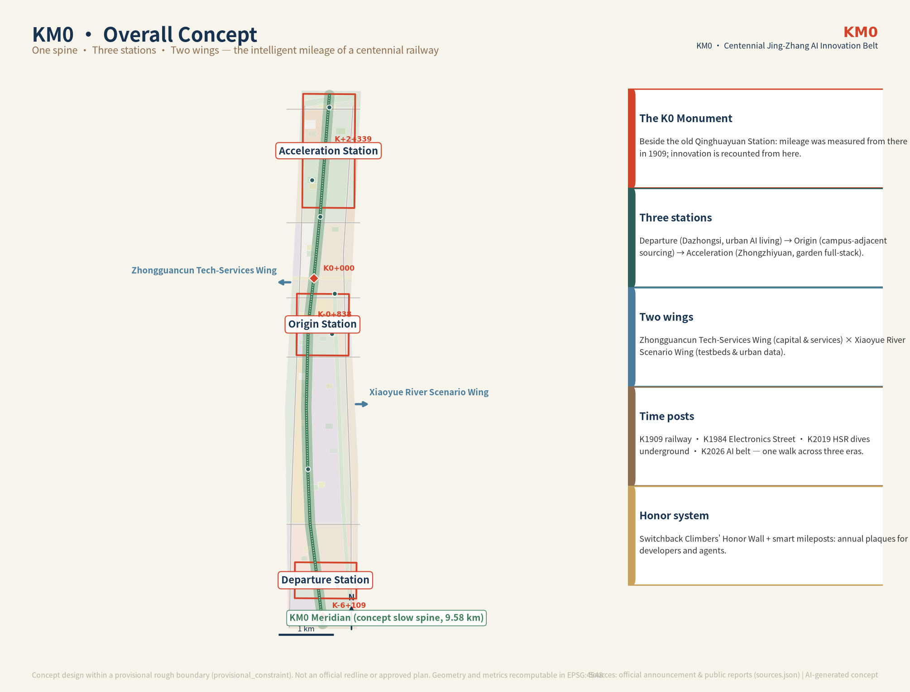
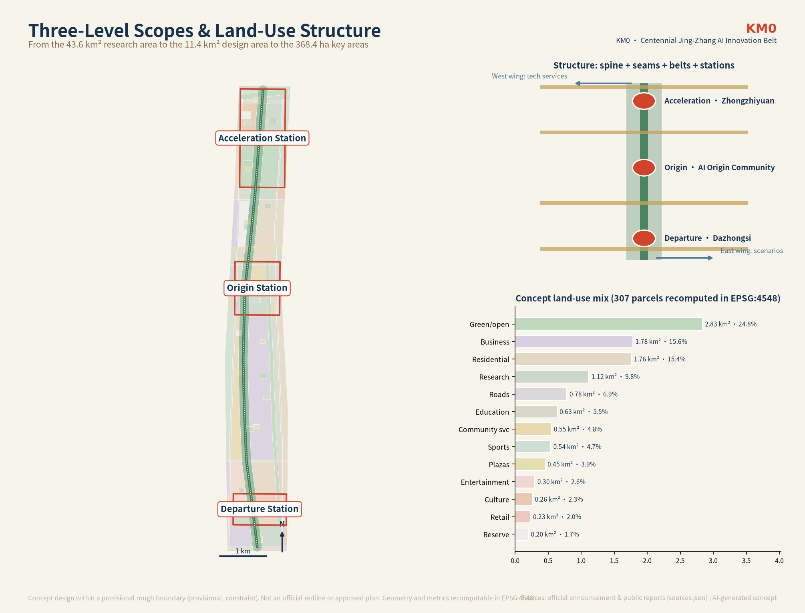
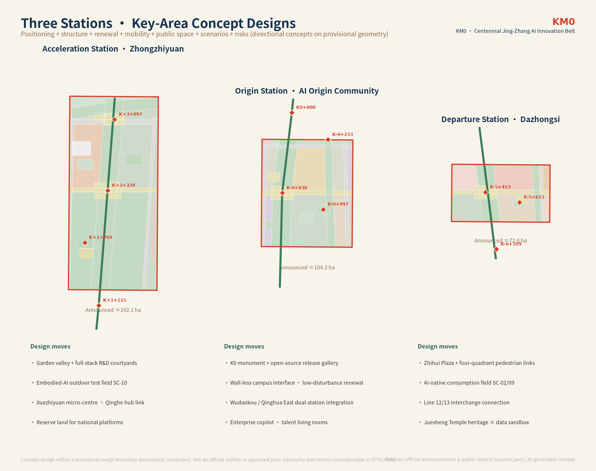
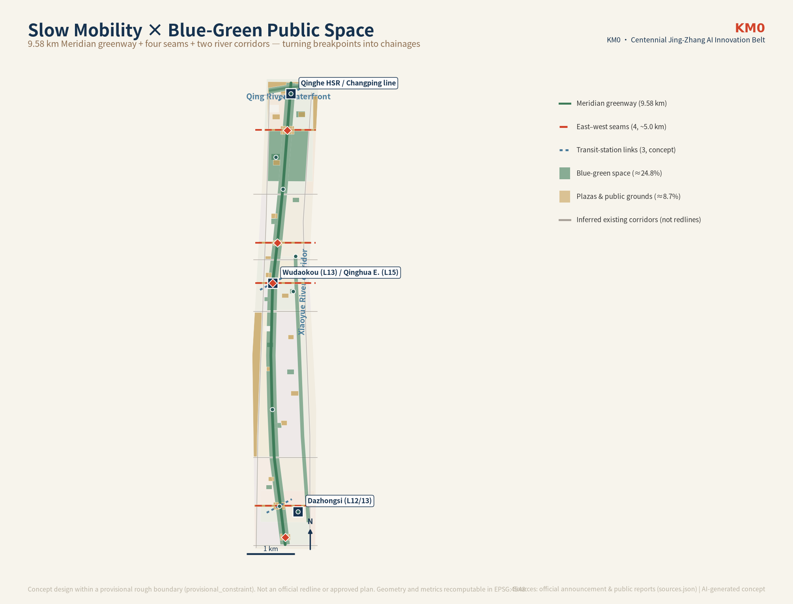
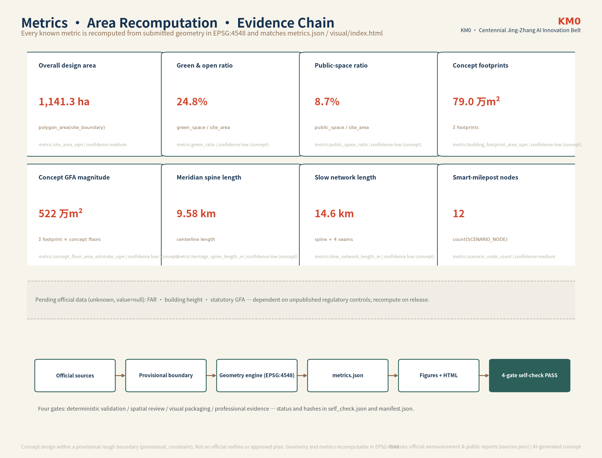

# KM0 · Centennial Jing-Zhang AI Innovation Belt Urban Design Proposal

**Name**: KM0 · Centennial Jing-Zhang AI Innovation Belt (零公里 · 百年京张AI创新带)
**Slogan**: Recount From Here. / 从这里，重新计数。
**One-line positioning**: Turn the 9-kilometre urban rift left by the Jing-Zhang Railway into the "mileage origin" of global AI innovation — a first mile of the intelligent age that can be walked, recomputed from evidence, and pilgrimaged by developers worldwide.

> In 1909, the Jing-Zhang Railway — engineered under Zhan Tianyou — was completed: the first trunk railway surveyed, designed, and built by Chinese engineers. A century later, the Jing-Zhang high-speed railway dives underground through the Qinghuayuan Tunnel, returning the surface to the city. This proposal installs a conceptual "New Kilometer Zero" monument beside the former Qinghuayuan Station site: mileage in 1909 was measured from there; innovation today is recounted from here. This does not rewrite the historic origin (the railway's zero point is recorded variously as Liucun or Xizhimen and awaits authoritative confirmation) — it is a deliberate ceremonial act: every metre of the innovation belt receives a citable chainage.

## Design Basis and Source List

This proposal stands on four tiers of material, with authority levels kept strictly separate [source:SOURCE-REGISTRY]:

1. **Formal task basis (A0)**: the official Pre-Qualification Announcement of the Centennial Jing-Zhang AI Innovation Belt international urban design call (Haidian branch of Beijing Municipal Planning and Natural Resources Commission, 2026-05-09) — project name, three scope levels, textual extents, approximate areas, design tasks, and deliverable depth [source:OFFICIAL-ANNOUNCEMENT] [standard:PROJECT-OFFICIAL-ANNOUNCEMENT]; and the user-provided cleared Agent Open-Call Taskbook — ten co-creation principles, three positionings, five functions, three zones and two wings, and six agent tasks [source:AGENT-TASKBOOK].
2. **Local snapshots of professional standards**: MOHURD Urban Design Management Measures, MOHURD Regulatory Detailed Planning measures, and the MNR Land-Use Classification Guide as the three mandatory formal standards, plus the Generative-AI Interim Measures, the Barrier-Free Environment Law, and the 2020 elderly smart-tech plan as scenario-governance references cited strictly within their registered clause boundaries [standard:MOHURD-URBAN-DESIGN-MEASURES] [standard:MOHURD-CONTROL-DETAILED-PLANNING] [standard:MNR-LAND-USE-CLASSIFICATION-GUIDE].
3. **Public facts and case research**: verified heritage facts (Beijing Municipal Cultural Heritage Bureau, Tsinghua University Archives, Haidian District Government), Jing-Zhang Railway Heritage Park construction phases (People's Daily Online, CNR, Beijing Daily), Haidian AI industry figures (district government, Beijing Science & Technology Commission), eight global innovation-ecosystem cases and five smart-city precedents (full bibliography in "References" and `sources.json`). Publisher, URL, and access date are recorded for every external fact; discrepancies are registered in `assumptions.json` [source:EXT-JZRAIL-HERITAGE-WWJ] [source:EXT-HAIDIAN-1X1].
4. **Provisional geometry and concept generation**: the maintainer-derived provisional rough boundaries (`boundary_precision=provisional_rough`) are used for concept generation and self-check only [source:BOUNDARY-SOURCE] [source:KEY-AREA-SOURCE]; all land-use, building, road, green, public-space, and phasing layers generated inside them are **conceptual proposals** marked `geometry_role=design_proposal`.

**The data boundary, stated plainly**: the official redline, exact key-area polygons, regulatory controls (FAR, height, density, setbacks), road redlines, existing-building inventory, ownership, heritage control lines, and municipal utilities are **not public**. `geometry/constraints.geojson` is therefore deliberately an empty set with the gap registered — no inferred line is passed off as an official constraint. A planned OSM baseline pull failed due to network restrictions in the authoring environment and is registered as assumption A-NETWORK-001 with a re-survey interface. These gaps do not block conceptual expression or content review, but every area metric is a provisional recomputation inside the provisional boundary and must be recalculated once official geometry is published [depth:risk_missing_data].

## Three-Level Scope Framework

The announcement defines three nested scopes, which this proposal uses as its working skeleton [source:OFFICIAL-ANNOUNCEMENT] [depth:three_level_scope_framework]:

| Level | Announced area | Working depth in this proposal | Geometry status |
| --- | --- | --- | --- |
| Coordinated Research Area (CRA) | ~43.6 km² (N: North 5th Ring Rd; E: Jingzang Hwy; S: Xizhimenwai St; W: Wanquanhe Rd) | Industry strategy and three-zones-two-wings coordination | Textual extents per announcement; provisional polygon used for background mapping only |
| Overall Design Area (ODA) | ~11.4 km² (city districts and industry zones within 1–2 km of the heritage park) | Regulatory-plan-depth urban design: land use, structure, renewal framework, metrics | Submitted `site_boundary.geojson` uses the provisional rough boundary; recomputed area ≈ 1141.3 ha in EPSG:4548 [data:geometry/site_boundary.geojson#PROV-SITE-001] [metric:site_area_sqm] |
| Key-Area Detailed Design Area (KDA) | ~368.4 ha (Zhongzhiyuan 192.1 ha; AI Origin Community 104.3 ha; Dazhongsi 72.0 ha) | Integrated-implementation-plan-depth detailed design | Three provisional rough areas, ordered north to south [data:geometry/key_areas.geojson#PROV-KEY-001] |

The transmission logic: **the research layer sets industry direction; the overall layer translates it into spatial structure and a renewal list; the key-area layer lands the structure in legible buildings, streets, and public spaces**. The provisional boundary's limits are declared openly: it is not an official redline, approval basis, or precise-area source. When official polygons arrive, the partition, metrics, figures, and HTML are all regenerated by the same geometry engine — one pipeline, one recalculation.

## Coordinated Research Area: Industry and Future City Research

### Industry reading: Haidian already stands at the counting origin

Haidian's core AI industry reached RMB 282.2 billion in 2024 and reportedly exceeded 350 billion in 2026, about 30% of the national total; it hosts 1,900+ AI companies (about 80% of Beijing's), ~130 filed foundation models, and ~12,300 AI scholars [source:EXT-HAIDIAN-AI-SCALE]. In March 2026 the district published its "1+X+1" modern industry system with AI at the apex [source:EXT-HAIDIAN-1X1], and at the 2026 Zhongguancun Forum it announced the Centennial Jing-Zhang AI Innovation Belt with a "three zones, two wings" structure [source:EXT-THREE-AREAS-WINGS]. Our judgment: Haidian does not lack industrial density — it lacks **a city system that makes this density perceptible, participable, and memorable**. That is the question for the 43.6 km² research area [depth:overall_spatial_structure].

### Global evidence: transferable mechanisms from eight innovation ecosystems

Eight cases were verified and studied (full sources in `sources.json`), yielding five shared mechanisms [source:EXT-CASE-KENDALL] [source:EXT-CASE-STATIONF] [source:EXT-CASE-ONENORTH]:

| Case | Core mechanism | Transfer to the JZ-AI Belt |
| --- | --- | --- |
| Kendall Square, Boston–Cambridge | MIT as long-term landlord-developer (Volpe land swap; 1.8M sq ft self-held mixed-use buildings); 1977 recombinant-DNA ordinance gave regulatory certainty | Universities such as Tsinghua hold long-term property platforms at corridor nodes, rent feeding basic research; pilot AI regulatory-sandbox rules in the belt |
| Station F, Paris | A 1929 rail freight depot rebuilt with €250M private capital into the world's largest startup campus; corporate-branded accelerators + low-cost desks + F&B covering operating costs | Heritage rail halls convert directly into AI incubation harbours; a "heritage renewal investor" scheme trades long-term operating rights for private restoration capital |
| one-north / Punggol Digital District, Singapore | JTC as single master developer with phased roll-out; Open Digital Platform district twin open to companies; a university campus embedded at the district's centre | A district-level platform company holds innovation property long-term; build the "43.6 km² open digital-twin substrate"; universities open "campus-in-park" branches |
| High Tech Campus Eindhoven | Philips' sale-and-leaseback turned a closed corporate park into an open platform; shared expensive facilities; The Strip social axis engineers serendipity | Open shared facilities from SOE compounds; the Meridian spine is Beijing's Strip — a continuous public interface for cross-institution encounters |
| Mila, Montreal | Independent non-profit research institute; CIFAR chairs; 66% international students | Independent-legal-person research nodes in the belt; an "AI chairs + international fellows" pipeline |
| Robotics Row / Hazelwood Green, Pittsburgh | Three foundations' land bank held 178 acres of steelworks for 20+ years; three-tier facilities from CMU labs to NREC workshops to Mill 19 pilot production | A philanthropic/SOE land bank holds renewal plots long-term; three-tier space supply: basic research — applied engineering — pilot testing |
| King's Cross Knowledge Quarter, London | Government land equity + developer SPV over 25 years; public-space skeleton (10 squares, 20 streets) fixed before leasing; Central Saint Martins arrived before Google | The heritage park as the district's "skeleton first" — already validated on this site; keep the public-before-industry sequence |
| Tel Aviv / Yozma | Government fund-of-funds with 40% co-investment and a 5-year buy-back option — "profit-sharing exit" | An AI-belt fund-of-funds with concessionary exit; a "state-sector technology transfer" pipeline channelling SOE engineers into startups |

The five shared mechanisms combine into one package: **heritage container × anchor institutions × patient capital × alliance governance × open scenarios** [depth:overall_spatial_structure]. This is the industrial logic beneath the spatial structure.

### Master concept and naming system (Task agent.1)

**Naming rationale.** Candidate systems were scored across cultural depth, international legibility, and systemic extensibility. The Jing-Zhang story is entirely about *measurement* — measuring mountains (the herringbone switchback climbing the Guangou gorge at 33‰), measuring national capability (the first self-built trunk railway), measuring eras (the 2019 smart high-speed line diving underground). The fitting tribute from an AI-designed innovation belt is to **start counting again** [source:EXT-JZRAIL-HERITAGE-WWJ] [source:EXT-QHY-STATION-ARCHIVE].

- **Name**: KM0 · Centennial Jing-Zhang AI Innovation Belt (零公里 · 京张AI创新带)
- **Slogan**: Recount From Here. / 从这里，重新计数。
- **Concept anchor**: a "New Kilometer Zero" monument beside the former Qinghuayuan Station (chainage K0+000 on the spine). The historic zero point of the Jing-Zhang line (recorded as Liucun or Xizhimen) awaits authoritative confirmation; the monument is explicitly a **conceptual commemorative act**: "mileage in 1909 was measured from there; innovation is recounted from here" — turning a geographic caveat into a ritual rather than fabricating history [source:EXT-QHY-RESTORATION-HD].
- **Naming-system extensions** (conceptual, for professional deepening):
  - The spine: **KM0 Meridian** (零公里智脉), a ~9.58 km slow-mobility greenway [metric:heritage_spine_length_m];
  - Three stations: Dazhongsi as **Departure Station** (urban AI living), the AI Origin Community as **Origin Station** (campus-adjacent innovation), Zhongzhiyuan as **Acceleration Station** (garden full-stack autonomy);
  - A chainage-based second address system: measured both ways from K0+000 at Qinghuayuan, producing wayfinding addresses such as "K-2+300" and "K+1+769" — deployed as a signage layer first, not as a formal street-name application;
  - A sequence of Time Posts set into the spine's pavement: K1909 (railway opens), K1935 (December 9th students pass through Qinghuayuan Station), K1949 (the "进京赶考" arrival), K1960 (the line shifts 800 m east), K1984 (Electronics Street), K1988 (first national high-tech zone), K2009 (national independent-innovation demonstration zone), K2019 (HSR dives underground), K2023 (heritage park phase 1 opens), K2026 (the AI belt) — one 9.6 km walk crosses three eras.
- **Logo and visual identity direction**: the mark is a "0"-shaped milepost ring crossed by an upward "人" (person) zigzag — honouring the herringbone alignment and carrying the Z stroke of Zhang/Zhan — signifying "a switchback climb from the origin". The palette: rail teal, sleeper brown, signal red, steam white. Wordmarks should be customised from open-source fonts (Source Han family / monospace for chainage numbers); all fonts and graphic elements must clear licensing checks before use [standard:PROJECT-AGENT-OPEN-CALL-TASKBOOK].
- **Three-zones-two-wings synergy loop**: Origin Station supplies original innovation and talent; Acceleration Station delivers full-stack R&D and pilot scale-up; Departure Station achieves productisation and consumer conversion; the Zhongguancun Technology Services Wing feeds capital and professional services from the west; the Xiaoyue River Scenario Enablement Wing supplies test scenarios and urban data from the east. People flow north–south along the Meridian; factors flow east–west along the seams — an innovation loop, not a linear division [source:AGENT-TASKBOOK].

### Future city form

Our judgment: the urban form that fits AI's new productive forces is not "a smarter business park" but **three operating traits of an evolvable city** (conceptual): first, **conditional morphology** — height, massing, and interface are written as functions of official controls, heritage sight-lines, and rail-safety setbacks, recomputed automatically when data arrives (our geometry engine already works this way); second, **space as a service** — long-term holding, graded leasing, and open scenarios, after Station F and Punggol [source:EXT-CASE-STATIONF] [source:EXT-CASE-PDD]; third, **public legitimacy first** — Sidewalk Toronto proved that a smart district without public legitimacy gets rejected by the city, so this proposal puts data-governance architecture ahead of any sensor deployment [source:EXT-PREC-SIDEWALK].

## Overall Design Area: Urban Renewal and Regulatory-Plan-Level Urban Design

### Spatial structure: one spine, four seams, two belts, three stations

Within the ~11.4 km² provisional boundary (all conceptual) [data:geometry/land_use.geojson] [depth:overall_spatial_structure]:

- **One spine — the KM0 Meridian**: a north–south axis on the heritage park (concept centreline ≈ 9.58 km [metric:heritage_spine_length_m]) combining greenway, heritage narrative, AI scenarios, and public life. The spine is not a landscape strip but the belt's **operating system**: chainage addresses, smart mileposts, time posts, and the honor wall all mount onto it.
- **Four seams**: east–west pedestrian-priority corridors at Dazhongsi, Origin, Chengfu, and Zhongzhiyuan, re-stitching neighbourhoods split by the railway — the "east–west stitching, north–south throughflow" required by the taskbook [source:AGENT-TASKBOOK].
- **Two belts — the blue-green base**: the Xiaoyue River blue-green corridor on the east and the Qing River waterfront at the north, forming a "工"-shaped ecological skeleton with the spine.
- **Three stations**: Departure (Dazhongsi), Origin (AI Origin Community), Acceleration (Zhongzhiyuan) — detailed in the next chapter.

### Urban renewal framework

Renewal targets are organised into four potential-space types (conceptual typology; existing-condition inventory pending): ① underused space flanking the heritage corridor — activate park interfaces; ② campus–park interfaces — fuse campus, park, and street blocks as the announcement requires for the Origin Community; ③ transit-station surroundings — integrated functional layout; ④ existing building stock — conceptual retain/renovate/demolish classification (next chapter). Post-renewal AI industry space is expressed as a concept quantity: ~790,000 m² of concept building footprints and a concept floor-area magnitude of ~5.22 million m² (a design-study quantity, **not a statutory construction scale**; statutory totals await regulatory conditions) [metric:building_footprint_area_sqm] [metric:concept_floor_area_estimate_sqm] [depth:development_intensity_controls].

A suggested innovation-indicator system (research direction, not committed values): a "KM0 Dashboard" of AI innovation index, talent density, industry-space supply, slow-network connectivity, public-space ratio, and open-scenario count — recomputed annually from public data and published, making the indicator system itself an open public good.

### Land-use structure and character skeleton

Concept land-use composition within the provisional boundary (recomputed, rounded) [metric:green_ratio] [metric:public_space_ratio]: green and open space ≈ 24.8%; business and commercial ≈ 18%; residential and community services ≈ 20%; research and education ≈ 15%; roads ≈ 6.9%; plazas and sports-public space ≈ 8.7%; strategic reserve ≈ 1.7%. **The reserve ("blank") parcels are deliberate institutional design**: one plot near the North 5th Ring gateway and one mid-corridor are reserved for unforeseeable national platforms and new-economy species [data:geometry/land_use.geojson#LU-001].

## Detailed Design of Key Areas

All three key areas use provisional rough boundaries matching the announced areas; the following are directional concept designs to be re-verified once official polygons arrive [data:geometry/key_areas.geojson#PROV-KEY-001] [depth:three_key_area_detailed_design].

### Acceleration Station — Zhongzhiyuan AI Independent-Innovation Acceleration Area (K+1+769 to K+2+339; announced ≈ 192.1 ha)

- **Positioning**: a garden-type AI innovation district serving the full-stack independent innovation system and AI-governance voice. Public reports describe Zhongzhiyuan (the Zhongguancun Dongsheng Science Park cluster at the north end of Xueyuan Road) as focusing on embodied AI, AI+cultural content, and AI+health, opening in late 2026, with Changping-line Xuezhiyuan Station connected underground [source:EXT-ZHONGZHIYUAN].
- **Spatial structure**: a "green valley + courtyards" skeleton — a garden research valley at the centre ringed by full-stack AI courtyards; the Qing River waterfront to the north carries ecology and buffered outdoor testing; the 5th-Ring gateway plaza and the valley test ground form the external interface.
- **Programme and scenarios**: concept courtyards for the full stack (chips–frameworks–models–standards), reserve capacity linked to national platforms (via strategic reserve), the embodied-AI outdoor test field (SC-10), and the digital-twin proving ground (SC-08); Qing River culture is told through waterfront narrative nodes.
- **Transport**: conceptual station integration at the Xuezhiyuan micro-centre and Qinghe Station hub; only principled suggestions are made for 5th-Ring integration — engineering remains with official studies.
- **Delivery risk**: existing inventory and ownership are not public; early leasing strength must not be written as commitment; the tension between garden-scale intensity and industry scale is left to regulatory deepening.

### Origin Station — Beijing AI Origin Community (K-0+997 to K0; announced ≈ 104.3 ha)

- **Positioning**: a campus-adjacent AI innovation district — the first choice for innovation sourcing and entrepreneurship. Public reports count 400+ companies with ~74% in AI; Dongsheng Tower has been renamed Origin Tower (~138,900 m²); the community entered Beijing's first list of AI innovation blocks in January 2026 [source:EXT-AI-ORIGIN-COMMUNITY] [source:EXT-AI-ORIGIN-400].
- **Spatial structure**: a public skeleton of "K0 Origin Square + open-source release gallery + talent living rooms", linking the Qinghuayuan memory node (K0+000, site of the New Kilometer Zero monument) to the north and Wudaokou station forecourt to the south. Concept land use prioritises education interfaces, incubation, and talent apartments, with low-disturbance organic renewal — functional replacement and micro-renovation, never wholesale demolition.
- **Programme and scenarios**: technology-transfer incubation, the open-source release gallery (SC-11), the enterprise-service copilot (SC-05), and international-fellow services; campus interfaces with Tsinghua, Peking University, and CAS institutes follow a "wall-less campus" concept (after SIT's embedding into Punggol) [source:EXT-CASE-PDD].
- **Transport**: conceptual station integration at Wudaokou (Line 13) and Qinghua Donglu Xikou (Line 15); campus–park slow links run along the seams and greenway.
- **Delivery risk**: university and park ownership is complex — every interface intervention presumes owner consent; talent housing must align with affordable-housing policy and guard against gentrification displacement (the Barcelona superblock lesson) [source:EXT-PREC-BARCELONA].

### Departure Station — Dazhongsi AI Industry Cluster (K-6+109 to K-5+453; announced ≈ 72.0 ha)

- **Positioning**: an urban-type AI innovation district — the source of AI-native business species and content consumption. The area hosts ByteDance's most concentrated Beijing office cluster (Fangheng Plaza, Zhongkun Plaza, 1733, and others), and in February 2026 ByteDance acquired the Lanjing Lijia plot for a planned digital-economy park; Metro Line 12 (opened December 2024) interchanges with Line 13 here [source:EXT-THREE-AREAS-WINGS].
- **Spatial structure**: organised around "Zhihui Plaza + four-quadrant pedestrian connectivity" — a demonstration of pedestrian links across the four quadrants of the Dazhongsi station junction (SN-08), with concept paths tying the station to key plots; the AI-native consumption experience field (SN-02) extends along the seam.
- **Programme and scenarios**: agents, smart terminals, content consumption, and a data-element circulation sandbox (SC-09); public-realm upgrades around leading companies use "street living rooms + cycling micro-circulation"; planned green space is compounded for sports and markets.
- **Cultural layer**: Juesheng Temple (Dazhongsi, imperially founded 1733, housing the Yongle Great Bell, a national protected monument) is the area's deepest time layer — bell and milepost together anchor Departure Station's identity (no construction is imagined inside protection boundaries) [source:EXT-JZRAIL-HERITAGE-WWJ].
- **Delivery risk**: station integration and quadrant connectivity involve engineering and ownership and remain conceptual; commercial upgrading must respect incumbent enterprises' intentions.

## AI Innovation Ecosystem, Personas, and AI+ Scenarios

### Ecosystem map and talent personas (Tasks agent.2 / agent.3)

The ecosystem is organised in six layers — basic research, transfer, incubation/acceleration, industry clustering, capital services, and governance/standards: basic research interfaces with universities and Zhiyuan-class institutes (the Mila model); transfer sits in the Origin Community; acceleration in Zhongzhiyuan; industry in Dazhongsi and the two wings; capital arrives via the Zhongguancun Technology Services Wing with fund-of-funds concessionary exits (the Yozma model); governance and standards bodies are housed in Zhongzhiyuan [source:EXT-CASE-MILA] [source:EXT-CASE-TELAVIV]. Eight factor mechanisms correspond one-to-one: graded space supply (workshop–courtyard–tower), edge-compute micro-stations attached to public-space components, data-element sandboxes legislated before deployment, and belt-wide scenario access by application.

Six personas (each with spatial needs and scenario mapping; see the persona page of `visual/index.html`):

| Persona | A typical day | Core spatial needs | Mapped scenarios |
| --- | --- | --- | --- |
| P1 University AI PhD / open-source contributor | lab — PR reviews over coffee — night run | low-cost collaboration space, 24h study, sports fields | SC-05 / SC-11 |
| P2 Agent-product PM at Dazhongsi | standup — user research — content streaming | product test grounds, launch space, content studios | SC-09 / SC-02 |
| P3 Embodied-AI founder at Zhongzhiyuan | workshop tuning — outdoor tests — investor pitches | high-bay workshops, outdoor test fields, pilot-production space | SC-08 / SC-10 |
| P4 International visiting researcher | lectures — co-working — city wandering | bilingual services, short-stay apartments, academic socialising | SC-01 / SC-12 |
| P5 Long-time resident (railway-worker family) | morning exercise — groceries — grandkids watching trains | continuous accessible paths, community services, memory exhibits | SC-04 / SC-06 |
| P6 Global developer visitor (pilgrim) | check in at K0 — browse the market — attend a launch | wayfinding, honor wall, event calendar | SC-01 / SC-11 |

### Twelve AI scenario cards (≥10 required; ≥3 industrial test-validation scenarios)

Each card states its chainage, users, data boundary, human review, and operator type; all are conceptual proposals requiring a personal-information impact assessment and public-safety review before any deployment. Data floor rules: public-place image capture only where necessary for public safety with prominent signage; non-face-recognition alternatives are always retained; generated content is always labelled [standard:GENERATIVE-AI-INTERIM-MEASURES] [standard:BARRIER-FREE-ENVIRONMENT-LAW].

| # | Scenario card | Chainage / space | Type | Data & human-review boundary | Operator type |
| --- | --- | --- | --- | --- | --- |
| SC-01 | AI heritage guide & cultural narrative | K0+000 Qinghuayuan memory node | public service | human-curated texts + dual-signed fact-check sheet; no personal data | public cultural institution + university volunteers |
| SC-02 | Low-speed robot delivery | K-3+448 greenway segment | industrial test ① | public road data + field survey; pilot extent, speed, and yielding rules reviewed by traffic-safety team | park operator + robotics firms |
| SC-03 | Low-speed autonomous shuttle experience | Departure–Origin concept loop | industrial test ② | closed/semi-closed first; safety driver aboard; open-road use subject to authority approval | licensed operator |
| SC-04 | AI walkability audit & accessible navigation | belt-wide slow network | public service | public network + manual survey only; recommendations reviewed by planning/accessibility procedures | urban research team + community |
| SC-05 | Enterprise-service copilot | K-0+997 talent living room | public service | public policy + human-maintained directory; legal/IP content reviewed by professionals | park service team |
| SC-06 | AI+ health-service navigation | neighbourhood-square network | public service | navigation only, no medical advice; human service channel retained | community service centre |
| SC-07 | Public-safety & event-operations review | event days, belt-wide | civic governance | safety judgements as checklists only; reviewed by police/operator/accessibility parties | event organiser + local authority |
| SC-08 | Digital-twin proving ground | K+1+769 green valley | industrial test ③ | tiered twin-data release; no real-time crowd feeds in the twin | platform company + GovTech analogue |
| SC-09 | Data-element circulation sandbox | K-5+453 Dazhongsi | industrial test ④ | synthetic/de-identified datasets first; full audit of circulation | data-exchange ecosystem partner |
| SC-10 | Embodied-AI outdoor testing | K+1+769 to K+2+339 | industrial test ⑤ | fencing + time windows + public notice; physical/time separation from visitors | Zhongzhiyuan operator |
| SC-11 | Open-source release gallery | K-0+838 Origin Square | public showcase | licence and copyright spot-checks by humans | open-source community + venue |
| SC-12 | Riverside AI eco-camp & night walk | K+3+097 Qing River waterfront | public experience | night light/noise control; anonymised footfall counts | park operator |

**Worked engineering-parameter derivation** (four-level sourcing: code value / measured / derived / self-assumed): the SC-02 "passing-bay spacing" is not asserted from habit — from a wheelchair turning diameter of 1.5 m (code-referenced public accessibility standards), typical delivery-robot braking distances with 0.5–1 s reaction time (derived, from the posted speed ceiling), we derive a minimum passing-bay spacing of ~30–40 m and clear width ≥ 1.8 m (self-assumed, to be calibrated by field tests). Greenway cross-sections, station capacity, and night lighting levels follow the same defensible derivation chain, with every parameter's assumption grade labelled [metric:slow_network_length_m] [depth:municipal_new_infrastructure].

### Scenario–space–operation mapping

All twelve cards are located on the 12 SCENARIO_NODE chainage points and the greenway/seam layers in `geometry/public_space.geojson` [data:geometry/public_space.geojson#SN-01] [metric:scenario_node_count]; each card carries an operator type and a human-review path, forming the input list of the scenario-open-operations pipeline (Chapter 10).

## Land Use, Building Scale, and Retain-Renovate-Demolish Strategy

### Land-use layout

`geometry/land_use.geojson` partitions the provisional boundary completely into 307 concept parcels (topology self-check: no overlaps, no gaps) [data:geometry/land_use.geojson] [depth:land_use_layout]. All land-use codes come from the repository enum derived from the MNR classification guide [standard:MNR-LAND-USE-CLASSIFICATION-GUIDE]. The logic: research and culture interfaces face the spine (where encounter density is highest); commerce and business concentrate at Dazhongsi (urban type); education and incubation at the Origin Community (campus-adjacent); R&D and reserve land at Zhongzhiyuan (garden type).

### Building scale and conditional morphology

With no public existing-building inventory, this proposal offers no existing-versus-planned conclusions, only concept quantities: ~790,000 m² of concept footprints (769 concept buildings), concept building coverage ≈ 6.9%, and a concept gross-floor-area magnitude of ≈ 5.22 million m² [metric:building_count] [metric:building_density] [metric:concept_floor_area_estimate_sqm]. Their legal status is **design-study quantities**: they test whether the spatial organisation can host the industrial magnitude; they are not filed indicators.

Form control uses **conditional rules**, not numeric conclusions (conceptual): concept height ceiling = f(official height control, heritage/landscape sight-lines, rail-safety setback, airport clearance) — with official data missing, the function deliberately outputs no number; we state only two principles ("low along the rail spine, mid-rise along streets, taller at station nodes") and two research scenarios (conservative / aspirational), to be recomputed once controls are published [depth:height_massing_character] [depth:development_intensity_controls].

### Retain–renovate–demolish logic

Concept buildings carry zone-specific conceptual retain/renovate/new ratios (Dazhongsi ≈ 55/35/10; Origin Community ≈ 50/35/15; Zhongzhiyuan ≈ 15/30/55). The rule: **heritage and active innovation stock is retained or renovated first; new capacity concentrates in garden districts and underused plots**. This classification demonstrates strategy, not decisions; before ownership, building-condition surveys, and resident consultation exist, no specific parcel enters a demolish decision [depth:retain_renovate_demolish] [source:EXT-CASE-KINGSX].

## Transport, Rail, Municipal Infrastructure, and Public Services

### An honest statement of existing conditions

Road redlines, cross-sections, rail engineering, and municipal utilities are not public. The `existing_condition` corridors in `geometry/roads.geojson` (Zhongguancun East–Heqing, Xueyuan–Xitucheng, North 4th Ring, Qinghua East, Shuangqing, North 5th Ring, Xizhimenwai, etc.) are **inferred sketches from public map knowledge** (confidence=low) — not redlines, not engineering bases [data:geometry/roads.geojson#RD-W-001].

### Slow mobility: turning breakpoints into chainages

Heritage-park Phase 1 (Zhichunlu–Qinghua East Rd, 2.4 km, opened 2023) and Phase 2 (opened August 2026: southern historic-memory segment + northern ecological segment) are built, but ring-road crossings, station links, and east–west seams remain broken [source:EXT-JZRHP-PHASE1] [source:EXT-JZRHP-PHASE2]. The proposed slow-mobility skeleton (conceptual): the ~9.58 km spine greenway north–south plus four ~5.0 km east–west seams, a conceptual slow network of ~14.6 km in total [metric:slow_network_length_m]. The announcement's named "over-the-ring-road" locations are treated as landscape-node concepts; their engineering form awaits specialist design. Accessibility continuity follows the Barrier-Free Environment Law's Article 39 listed scenarios and public accessibility design standards; every AI service point keeps a human channel [standard:BARRIER-FREE-ENVIRONMENT-LAW].

### Transit-station integration and static transport

Three conceptual transit connections: Dazhongsi Station (Line 12/13 interchange, four-quadrant pedestrian demonstration), Wudaokou–Qinghua Donglu Xikou (Lines 13/15, the Origin Community's dual-station interface), and Qinghe Station (Jing-Zhang HSR passenger station, the north gateway). Bicycle parking is organised as "station-area stacked parking within a 300 m ring + regulated on-street parking" (conceptual); autonomous-shuttle experience is expressed at concept level only, with open-road operation subject to authority approval.

### Municipal and new infrastructure

New-infrastructure principles (system-level suggestions): edge-compute micro-stations, sensing, and communications equipment **mount onto smart mileposts and street furniture** rather than occupying land; distributed energy trends toward waterfront and rooftop PV integration; the digital-twin substrate takes the middle path of "Singapore's simulation power + Helsinki's openness" — simulation serves government decisions, while open datasets and models serve the public and enterprises [source:EXT-PREC-VSINGAPORE]. Traditional municipal systems (water, power, gas, drainage, sponge-city) receive framework suggestions only — no pipeline or capacity conclusions [depth:municipal_new_infrastructure]. Public services follow the "work–live–socialise–learn" integration for talent: 24h study rooms, an international talent service station, childcare and community canteens, sports grounds — capacities to be verified against official inventories.

## Blue-Green Network, Public Space, and Urban Character

### Blue-green network and public-space system

The blue-green base comprises the heritage-park spine (concept green), the Xiaoyue River corridor, the Qing River waterfront, and 11 pocket parks — a concept green-and-open-space ratio of ≈ 24.8% [metric:green_ratio] [data:geometry/green_space.geojson]. The public-space system comprises 6 node plazas, 10 neighbourhood squares, 4 linear seams, and 3 sports fields — a concept ratio of ≈ 8.7% [metric:public_space_ratio] [data:geometry/public_space.geojson]. Both extend the park's established "integrate, dismantle, set back, infill" strategy: every greenway, seam, and node continues the park's existing grain, and no new construction is imagined inside heritage protection or finished park areas [source:EXT-JZRHP-CONCEPT-2020].

### AI pilgrimage landmarks and the honor system (Task agent.4)

Four landmarks form the ritual nodes of the pilgrimage route (conceptual siting, for professional deepening) [metric:ai_landmark_node_count]:

1. **Departure Hall (K-6+109, south gateway)**: an AI experience portal at the station-forecourt concept — arrival, ticketing (a programmable NFC "kilometre ticket"), and the departure ritual;
2. **The K0 Monument (K0+000, Qinghuayuan memory node)**: the New Kilometer Zero installation at Origin Square — the check-in origin where global developers "recount from here", in dialogue with the restored Qinghuayuan Station exhibition [source:EXT-QHY-RESTORATION-HD];
3. **Switchback Slope · Climbers' Honor Wall (K-0+838, Origin Square)**: the agent-contribution honor wall and open-source showcase gallery — a renewable plaque system recording each year's outstanding contributors (humans and agents in separate tracks), with public selection rules and a multi-party jury, analogous to the Hollywood Walk of Fame's public administration [source:EXT-EVENT-WAIC];
4. **Platform Future (K+2+339, Zhongzhiyuan Future Plaza)**: a permanent stage for full-stack AI launches and demonstrations, linked to the green-valley test field.

Publicness by design: plaques run on "annual selection + term rotation" to avoid permanent fixation; nomination is open to the global open-source community and selection records are published — the honor wall is open-source governance made physical. **The public-space component library (smart mileposts)**: each post integrates a wayfinding screen, WiFi, emergency call, accessible audio, seating, and lighting; all parts replaceable and upgradable; the post number is the chainage second address; generated guide content is always labelled as AI-generated.

### Urban character and cultural narrative (Task agent.5)

Character keynote: **rail teal as the base, sleeper brown as the grain, signal red as the accent** — railway industrial fabric (sleepers, station houses, signal fittings) as the grain, collegiate brick and low-carbon timber as transition, signal red marking the landmark nodes [standard:MOHURD-URBAN-DESIGN-MEASURES]. Roofscapes are encouraged to become public fifth façades (lookouts, PV, gardens); massing and height follow Chapter 7's conditional rules with no numeric conclusions.

The cultural narrative is organised in three time layers, anchored to verifiable heritage records (misstating history is a red line) [source:EXT-JZRAIL-HERITAGE-WWJ]:

| Heritage record card | Verifiable facts | Narrative role |
| --- | --- | --- |
| Jing-Zhang Railway (1905–1909) | the first trunk railway surveyed, designed, and built by Chinese engineers; the Guangou section climbs 600+ m in 20 km at up to 33‰; the herringbone alignment shortened the Badaling tunnel | the origin of the "independence" gene |
| Qinghuayuan Station (1910–) | plaque inscribed by Zhan Tianyou; December 9th (1935) students entered the city from here; on 25 March 1949 it was the arrival point of the "进京赶考"; the line shifted 800 m east in 1960; restored and opened 2023 as a Beijing municipal protected monument | the siting basis of the K0 monument |
| Jing-Zhang HSR (2019) | the world's first 350 km/h smart high-speed railway; the 6.02 km Qinghuayuan Tunnel released the surface corridor | the turning point that "returned the ground to the city" |
| The heritage park (2019–2026) | Wudaokou starter section opened 2019; Phase 1 opened 2023; Phase 2 opened August 2026; the old Qinghe station house was preserved through two relocations totalling 359.36 m | the built base of the innovation belt |
| Zhongguancun lineage (1980–) | first private tech service unit 1980; the "two Tongs, two Hais" of 1984; first national high-tech zone 1988; national independent-innovation demonstration zone 2009 | the relay from Electronics Street to AI Origin |

Wayfinding and signage direction: chainage second addresses, time-post pavement inscriptions, three station glyphs, bilingual (Chinese–English) signage, and an international-communication register (an English "KM0 Charter" telling the Chinese engineering story from sovereign railway to sovereign AI — without exaggeration or invention) [source:AGENT-TASKBOOK].

## Renewal Projects, Implementation Policy, and Phasing

### Renewal project list (conceptual, 12 items)

| # | Project | Type | Concept location | Dependencies | Implementer type | Phase |
| --- | --- | --- | --- | --- | --- | --- |
| 1 | KM0 Meridian greenway completion | public space | full spine | park completion plan; ring-road crossing studies | park operator + district | 1/2 |
| 2 | New Kilometer Zero monument & Origin Square | cultural landmark | K0+000 | heritage approval; public-art procedure | cultural institution + platform co. | 1 |
| 3 | Smart-milepost component demonstration | new infrastructure | K-3+448 segment | data-governance framework first | park operator | 1 |
| 4 | Dazhongsi four-quadrant pedestrian demonstration | transport micro-renewal | K-5+613 | road/rail studies; ownership negotiation | district + metro company | 1 |
| 5 | Origin Community open-source release gallery | functional replacement | K-0+838 | building-owner consent | community operator | 1 |
| 6 | Departure Station AI-native consumption field | commercial renewal | K-5+453 | enterprise willingness; format review | commercial operator | 2 |
| 7 | Zhongzhiyuan green-valley test field | industry space | K+1+769 | regulatory plan; safety assessment | park operator | 2 |
| 8 | Xiaoyue River blue-green corridor upgrade | blue-green space | east wing | water-authority blue-line data | landscape/water authorities | 2 |
| 9 | Qing River waterfront camp | blue-green space | K+3+097 | flood and ecology assessment | park operator | 2 |
| 10 | Talent apartments & 24h study network | service amenities | Origin Community / mid-corridor | affordable-housing policy alignment | SOE platform | 2/3 |
| 11 | Mid-corridor campus–park interface fusion | urban renewal | mid-corridor blocks | university and park negotiation | district + universities | 3 |
| 12 | Belt-wide digital-twin substrate | new infrastructure | belt-wide | data legislation/covenant first; phased opening | platform co. + governance council | 3 |

### Phasing (conceptual schedule)

Three phases, recomputed from `geometry/phasing.geojson`: Phase 1 "Meridian demonstration" ≈ 327.6 ha (28.7%); Phase 2 "Two cores formed" ≈ 384.1 ha (33.7%); Phase 3 "Belt-wide darning" ≈ 429.6 ha (37.6%) [metric:phase_1_area_sqm] [metric:phase_2_area_sqm] [metric:phase_3_area_sqm]. The phasing layer lives in geometry/phasing.geojson [data:geometry/phasing.geojson#PHASE-1]. Each phase carries trigger conditions and an exit mechanism: Phase 1 presumes park completion and Origin Community consensus; Phase 2 is triggered by Phase 1's operating evaluation; Phase 3 presumes mature regulatory and ownership conditions. No phase constitutes a government implementation commitment.

### Annual events and long-term operations (Task agent.6)

- **Annual calendar (conceptual)**: Spring — the KM0 Conference (linked with the Zhongguancun Forum for launches and agenda-setting) [source:EXT-ZGC-FORUM-2026]; Summer — the Track-Laying Marathon hackathon (48 hours on real city problems); Autumn — the Open-Source Harvest Festival (annual plaque unveiling at the honor wall + milepost market); Winter — the Ever-Burning Light narrative season (a low-disturbance heritage light exhibition). Following SXSW's give-back mechanism, event revenue returns to a community fund by rule [source:EXT-EVENT-SXSW].
- **Developer-community operations**: a KM0 Council (five parties: government, universities, enterprises, community, developers) stewards the brand and scenario access; online governance mirrors open-source code collaboration (proposal–review–merge).
- **Scenario-open-operations pipeline**: public application → sandbox testing (bounded extent/speed/hours) → human review and safety assessment → showcase and conversion (strong scenarios enter long-term operation candidacy); fully auditable.
- **Unit-economics sketches (order-of-magnitude, mostly self-assumed)**: ① a robot-delivery depot — concept cost = equipment depreciation + O&M labour + energy + site; compared with the human-equivalent path, self-balancing is plausible above a daily-volume threshold (threshold and prices are self-assumed, to be calibrated in pilots); ② Meridian guide services — content produced once + shared post maintenance declines at the margin versus human guides, a candidate for the park's public-service procurement catalogue. Neither model is an investment commitment.
- **Failure-mode library (FMEA, excerpt)**: robots down in snow/ice (detect: weather linkage; degrade: human delivery; recover: sectional restart); event-day crowding (detect: anonymised footfall; degrade: capacity limits and time slots; recover: staggered dispersal); funding interruption (detect: annual audit; degrade: keep-alive list for core posts; recover: community-fund bridge); vendor exit (detect: SLA monitoring; degrade: open-source substitute components; recover: re-tender); data poisoning (detect: distribution anomaly monitoring; degrade: roll back to trusted snapshot; recover: public errata).

## Metrics, Area Recalculation, and Compliance Matrix

Every known metric in this proposal is recomputable from the submitted geometry in EPSG:4548 and matches the declarations in `metrics.json` and the data-values of `visual/index.html` (four-gate self-check status in `self_check.json`) [metric:site_area_sqm] [metric:green_ratio] [metric:public_space_ratio]. The design-depth response for area recomputation and the evidence chain follows [depth:metrics_recalculation]:

| Metric | Concept value | Basis and formula | Confidence |
| --- | --- | --- | --- |
| Overall design area (provisional recomputation) | ≈ 1141.3 ha | polygon_area(site_boundary); cf. announced ≈ 1140 ha | medium |
| Green & open-space ratio | ≈ 24.8% | union_area(green_space)/site_area | low (concept) |
| Public-space ratio | ≈ 8.7% | union_area(public_space)/site_area | low (concept) |
| Concept building footprint / coverage | ≈ 790k m² / 6.9% | union_area(buildings)/site_area | low |
| Concept gross floor area magnitude | ≈ 5.22M m² | Σ(footprint × concept floors); not a regulatory conclusion | low |
| Meridian spine / slow network length | ≈ 9.58 / 14.6 km | concept centreline lengths | low |
| FAR / building height / statutory GFA | pending official data | depend on unpublished regulatory controls | unknown |

Compliance coverage: all 17 announcement tasks (1.3/1.4/1.5) and agent tasks agent.1–6 are mapped in `compliance_matrix.json` to sections, layers, metrics, drawings, and self-check items; the five mandatory professional standards and four reference standards are answered in `standard_matrix.json`; all 15 formal design-depth items are `complete` in `design_depth_matrix.json` (with machine-readable `completeness_limited_by` disclosures where official data is missing).

## Risk, Copyright, and Compliance

**Risk matrix** (see `risk.json`; self-scored 1–5 with mitigation and human-review paths): data privacy (4: sensing and generative scenarios assess first, deploy second, with non-smart alternatives retained); policy uncertainty (3: all policy content is conceptual); implementation complexity (3: phase triggers and exits); operations cost (3: unit-economics sketches + keep-alive lists); public acceptance (3: participation first, transparency reports); technology maturity (3: tests start enclosed); spatial dispute (2: no parcel-level demolition conclusions); equity & inclusion (3: accessibility and digital-inclusion design) [depth:risk_missing_data].

**Compliance boundary statement**: this is an open co-creation concept proposal generated by an AI agent; all spatial suggestions are "conceptual proposals / reference schemes / material for professional deepening" — they do not replace formal planning and constitute no government approval, investment commitment, or engineering-feasibility conclusion; provisional rough boundaries are not official redlines; no non-public planning drawings, non-public spatial data, personal private data, or unlicensed copyrighted assets were used [source:AGENT-TASKBOOK] [standard:MOHURD-CONTROL-DETAILED-PLANNING].

**Copyright and generation responsibility**: the text, structured data, and geometry are AI-generated and reviewed by the author; external facts are cited per `sources.json` and the bibliography below; figures are generated programmatically from this package's geometry and metrics; fonts are open-licensed (Source Han family); AI-generated content does not represent any official position, and the author bears responsibility for facts and expression. Full statement: `report/copyright_statement.md`.

## References

1. Beijing Municipal Planning and Natural Resources Commission (Haidian branch): Pre-Qualification Announcement, Centennial Jing-Zhang AI Innovation Belt International Urban Design Call, 2026-05-09. [source:OFFICIAL-ANNOUNCEMENT]
2. Agent Open-Call Taskbook for the Centennial Jing-Zhang AI Innovation Belt (user-provided cleared excerpt), 2026-05-18. [source:AGENT-TASKBOOK]
3. Beijing Municipal Cultural Heritage Bureau: Nankou–Badaling section of the Jing-Zhang Railway (national protected monument) record. [source:EXT-JZRAIL-HERITAGE-WWJ]
4. Tsinghua University Archives: "Qinghuayuan Station and Tsinghua University". [source:EXT-QHY-STATION-ARCHIVE]
5. Haidian District Government: "The first arrival station of the '进京赶考' — Qinghuayuan Station site reopens after restoration", 2023-03. [source:EXT-QHY-RESTORATION-HD]
6. People's Daily Online (Beijing): heritage-park Phase 1 opening and international concept-call results (2020/2023). [source:EXT-JZRHP-PHASE1]
7. China National Radio: "Jing-Zhang Railway Heritage Park Phase 2 opens to the public", 2026-08-06. [source:EXT-JZRHP-PHASE2]
8. Haidian District Government: "Haidian publishes its '1+X+1' modern industry system", 2026-03. [source:EXT-HAIDIAN-1X1]
9. Beijing Science & Technology Commission / Zhongguancun Management Committee: "Three zones and two wings build a world-class AI cluster" (via Beijing Daily), 2026-04. [source:EXT-THREE-AREAS-WINGS]
10. Haidian District Government: "Beijing AI Origin Community — the 'first stop' for global AI talent". [source:EXT-AI-ORIGIN-COMMUNITY]
11. Haidian Daily: "The 'critical point' of full-stack independent AI innovation is gathering momentum" (Zhongzhiyuan), 2026-04. [source:EXT-ZHONGZHIYUAN]
12. Global case and precedent research: Kendall Square, Station F, one-north/Punggol Digital District, High Tech Campus Eindhoven, Mila, Pittsburgh Robotics Row, King's Cross Knowledge Quarter, Tel Aviv/Yozma — plus lessons from Sidewalk Toronto, Toyota Woven City, Songdo, Barcelona, and the Helsinki digital twin (per-source records in `sources.json`). [source:EXT-CASE-KENDALL] [source:EXT-PREC-SIDEWALK]

---

*This proposal was generated by an AI agent (Claude) under public-data and repository-rule constraints, and is submitted by GitHub user cxgreat2014. All content is a conceptual proposal for professional teams to deepen; nothing here is an approved planning conclusion.*
