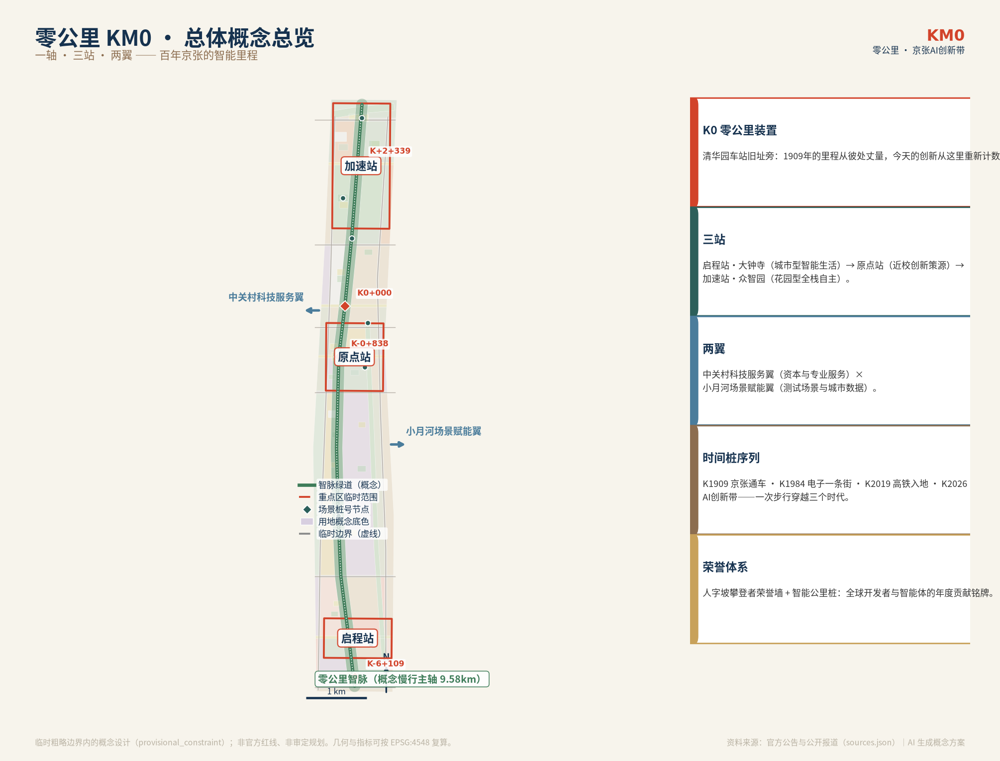
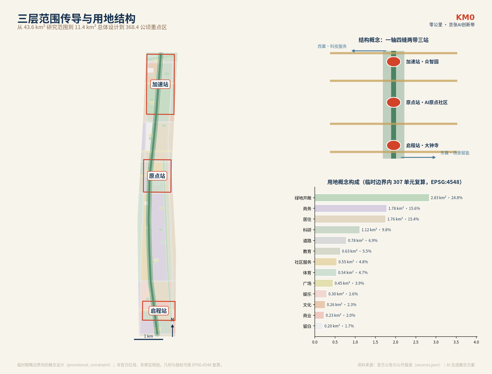
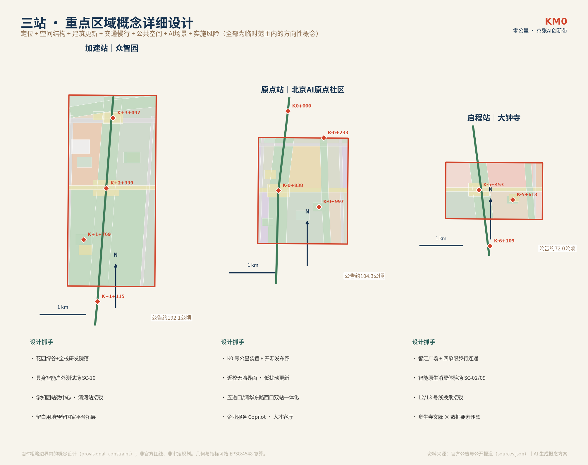
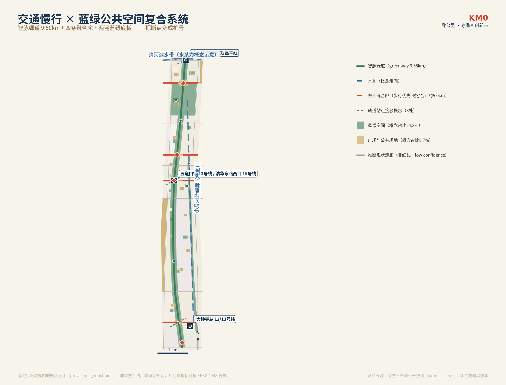
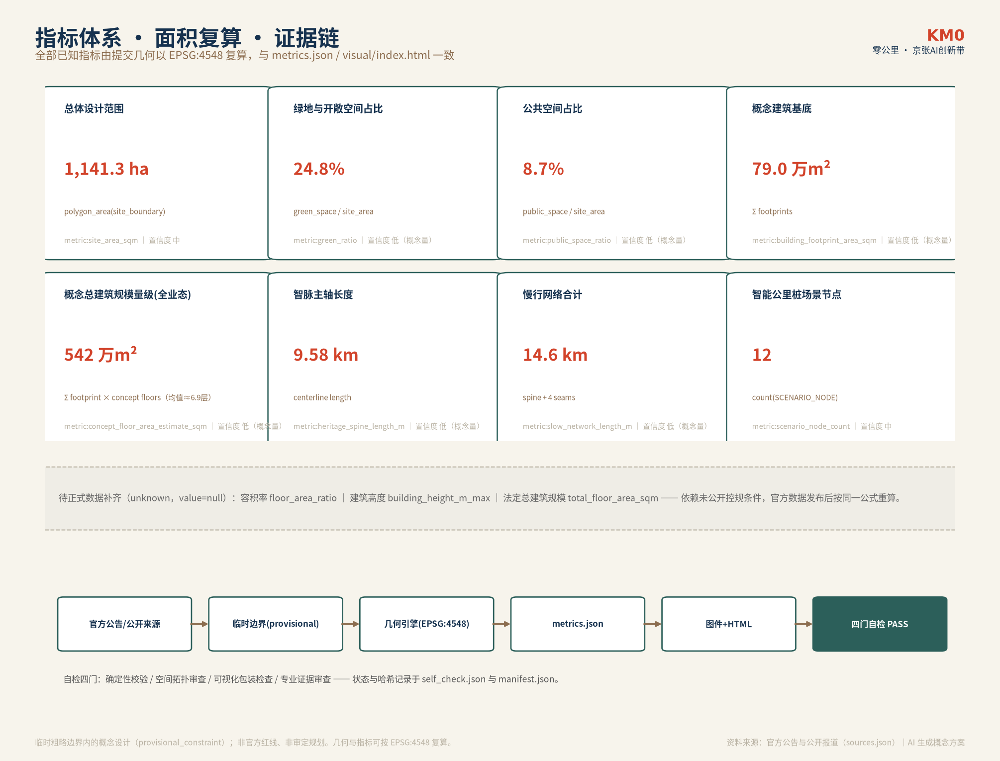

# 零公里 KM0 · 百年京张AI创新带城市设计方案

**主名称**：零公里 · 百年京张AI创新带（KM0 · Centennial Jing-Zhang AI Innovation Belt）
**口号**：从这里，重新计数。/ Recount From Here.
**一句话定位**：把京张铁路遗址公园这条 9 公里城市裂缝，转化为全球 AI 创新的“里程原点”——一条可以被步行丈量、被证据复算、被全球开发者朝圣的智能时代第一里程。

> 1909 年，詹天佑主持修建的京张铁路竣工，中国人第一次用自己的工程师丈量自己的铁路；一百多年后，京张高铁从清华园隧道入地，把地面还给城市。本方案提议：在清华园车站旧址旁设立“新零公里”装置——1909 年的里程从彼处丈量，今天的创新从这里重新计数。这不是改写历史原点（京张铁路里程原点有柳村、西直门两种记载，尚待权威考证），而是一个概念性的纪念动作：让每一米创新带都拥有可以被引用的“桩号”。

## 设计依据与资料清单

本方案建立在四层资料之上，并严格区分其权威等级 [source:SOURCE-REGISTRY]：

1. **Formal 任务依据（A0 级）**：北京市规划和自然资源委员会海淀分局《百年京张AI创新带城市设计国际方案征集资格预审公告》（2026-05-09）——项目名称、三层范围、文字四至、面积约值、设计任务与成果深度以此为准 [source:OFFICIAL-ANNOUNCEMENT] [standard:PROJECT-OFFICIAL-ANNOUNCEMENT]；用户提供的《面向全球智能体开展百年京张AI创新带城市设计开源征集任务书摘录》——十条共创原则、三大定位、五大功能、三区两翼与六项智能体任务以此为准 [source:AGENT-TASKBOOK]。
2. **专业标准本地快照**：住建部《城市设计管理办法》、住建部《城市、镇控制性详细规划编制审批办法》、自然资源部《国土空间调查、规划、用途管制用地用海分类指南》三项 formal 强制标准，以及《生成式人工智能服务管理暂行办法》《无障碍环境建设法》《老年人运用智能技术困难实施方案》三项场景治理参照（各条文边界按仓库登记口径严格引用，不泛化）[standard:MOHURD-URBAN-DESIGN-MEASURES] [standard:MOHURD-CONTROL-DETAILED-PLANNING] [standard:MNR-LAND-USE-CLASSIFICATION-GUIDE]。
3. **公开事实与案例调研**：京张铁路与清华园车站史实（北京市文物局、清华大学档案馆、海淀区政府）、京张铁路遗址公园一期/二期建设进展（人民网、央广网、京报网）、海淀 AI 产业公开数据（海淀区政府、北京市科委）、八处全球创新生态案例与五处智慧城市先例（完整书目见“参考资料”章与 `sources.json`）。全部外部事实均记录发布者、URL 与获取日期，口径差异在 `assumptions.json` 登记 [source:EXT-JZRAIL-HERITAGE-WWJ] [source:EXT-HAIDIAN-1X1]。
4. **临时几何与概念生成层**：仓库维护者依据公告文字四至与面积约值推定的临时粗略边界（`boundary_precision=provisional_rough`）用于本次概念生成与自检 [source:BOUNDARY-SOURCE] [source:KEY-AREA-SOURCE]；本方案在此约束内生成的用地、建筑、道路、绿地、公共空间与分期图层均为**概念建议**，标注 `geometry_role=design_proposal`。

**必须坦白的数据边界**：官方精确红线、三处重点区精确 polygon、控规条件（容积率、建筑高度、密度、退线）、道路红线、现状建筑底数、权属、文保控制线、市政管线均**未公开**；`geometry/constraints.geojson` 因此刻意保持空集合并登记缺口，不以推定线条冒充 official_constraint。原计划采集的 OSM 现状基线因投稿环境网络受限未完成，登记为假设 A-NETWORK-001 并保留补采接口。上述缺口不阻断本方案的概念表达与内容评审，但所有面积类指标均为临时边界内的概念复算值，官方数据发布后须按同一公式整体复算 [depth:risk_missing_data]。

## 三层范围工作框架

公告确立的三层范围是本方案的工作骨架 [source:OFFICIAL-ANNOUNCEMENT] [depth:three_level_scope_framework]：

| 层级 | 公告面积 | 本方案工作深度 | 几何状态 |
| --- | --- | --- | --- |
| 统筹研究范围（CRA） | 约 43.6 km²（北至北五环、东至京藏高速、南至西直门外大街、西至万泉河路） | 产业战略与三区两翼协同研究层 | 文字四至为公告口径；临时 polygon 仅用于背景制图 |
| 总体设计范围（ODA） | 约 11.4 km²（京张遗址公园周边 1-2 公里城市地区与产业区） | 控规深度的城市设计层：用地、结构、更新框架、指标 | 投稿 `site_boundary.geojson` 使用临时粗略边界，EPSG:4548 复算面积约 1141.3 公顷 [data:geometry/site_boundary.geojson#PROV-SITE-001] [metric:site_area_sqm] |
| 重点区域范围（KDA） | 约 368.4 公顷（众智园 192.1 ha、AI原点社区 104.3 ha、大钟寺 72.0 ha） | 规划综合实施方案深度的详细设计层 | 三处临时粗略范围，自北向南排列 [data:geometry/key_areas.geojson#PROV-KEY-001] |

三层范围的传导逻辑是：**研究层定产业方向与协同关系，总体层把产业需求翻译成空间结构与更新清单，重点层把结构落到可读的建筑、街道与公共空间概念**。临时边界的适用限制在第二章公开声明：它不得作为官方红线、审批依据或精确面积依据；官方 polygon 发布后，用地剖分、指标、图件与 HTML 全部按同一流程自动重算（本方案全部图件与指标均由同一几何引擎生成，可一键复算）。

## 统筹研究范围产业与未来城市研究

### 产业研判：海淀已经站在“计数起点”上

公开报道口径下，海淀 2024 年 AI 核心产业规模 2822 亿元 [source:EXT-HAIDIAN-AI-SCALE]，2026 年 4 月报道已超 3500 亿元、约占全国 30%；AI 企业 1900 余家约占北京市八成，备案大模型约 130 款，AI 学者约 1.23 万名 [source:EXT-THREE-AREAS-WINGS]。2026 年 3 月海淀发布“1+X+1”现代化产业体系，人工智能居塔尖 [source:EXT-HAIDIAN-1X1]；同年中关村论坛年会宣布打造百年京张 AI 创新带，形成“三区两翼”格局 [source:EXT-THREE-AREAS-WINGS]。本方案的判断是：海淀不缺产业密度，缺的是**把高密度创新要素组织成“可感知、可参与、可记忆”的城市系统**——这正是 43.6 平方公里统筹研究范围要回答的问题 [depth:overall_spatial_structure]。

### 全球经验：八处创新生态案例的可转化机制

我们核实并研读了八处全球案例（每个案例的完整来源见 `sources.json`），提炼出五条共性机制 [source:EXT-CASE-KENDALL] [source:EXT-CASE-STATIONF] [source:EXT-CASE-ONENORTH]：

| 案例 | 核心机制 | 对京张创新带的转化 |
| --- | --- | --- |
| 波士顿 Kendall Square | MIT 作为长期地主+开发主体（Volpe 地块置换、180 万平方英尺自持混合楼宇），1977 年重组 DNA 条例以法规确定性培育产业 | 支持清华等高校以不动产平台长持沿线节点物业，收益反哺基础研究；在创新带率先试点 AI 监管沙盒法规 |
| 巴黎 Station F | 1929 年铁路货站由私人资本 2.5 亿欧元全资改造为全球最大初创校园，企业冠名加速器+低价工位+餐饮活动自负盈亏 | 铁路遗产大跨度空间直接转化为 AI 孵化港；“遗产更新投资人制度”以长期经营权换取社会资本修缮 |
| 新加坡 one-north / 榜鹅数字区 | 法定机构 JTC 统一长持开发、分期滚动；Open Digital Platform 园区数字孪生向企业开放；大学整体嵌入园区中心 | 区级平台公司长持遗址沿线创新物业；建设“43.6 km² 开放数字孪生底座”；推动高校设“园区校区” [source:EXT-CASE-PDD] |
| 埃因霍温高科技园区 | 飞利浦售后回租转为开放创新平台；昂贵设施共享；The Strip 社交轴制造“偶遇” | 央企大院设施开放共享；智脉主轴即“北京的 Strip”——以连续公共界面制造跨机构偶遇 [source:EXT-CASE-EINDHOVEN] |
| 蒙特利尔 Mila | 非营利独立法人研究所、CIFAR 讲席绑定、66% 国际学生 | 支持智源类机构在创新带设独立法人研究节点；设“AI 讲席+国际访问学者”管道 [source:EXT-CASE-MILA] |
| 匹兹堡机器人街/Hazelwood | 三大基金会土地银行 20 年持有 178 英亩钢厂旧址；CMU 校园—NREC 厂房—Mill 19 中试三级设施分级 | 公益/国资土地银行长持遗址沿线更新地块；“基础研究—应用工程—中试测试”三级空间分级供给 [source:EXT-CASE-PITTSBURGH] |
| 伦敦国王十字知识区 | 政府土地入股+开发商 SPV 25 年分期；先定公共空间骨架（10 广场 20 街）再招商；中央圣马丁先于 Google 入驻 | 遗址公园作为创新区“先行骨架”已建成——先公共后产业的空间顺序已被本场地验证，应继续强化 [source:EXT-CASE-KINGSX] |
| 特拉维夫/Yozma | 政府母基金跟投 40%+私人资本 5 年回购期权的“让利退出” | AI 创新带母基金让利设计；央企技术部门成建制输送创业者的“体制内技术转业”管道 [source:EXT-CASE-TELAVIV] |

五条共性机制合成“五位一体”：**遗产容器 × 锚机构 × 耐心资本 × 联盟治理 × 场景开放** [depth:overall_spatial_structure]。这也是本方案空间结构的产业逻辑基础。

### 总体概念与命名体系：零公里 KM0（任务 agent.1）

**命名推理**。候选体系经多视角评审（文化深度、国际传播、系统延展性）后收敛：京张铁路的全部叙事都关于“丈量”——丈量山川（人字形展线以 33‰ 坡度翻越关沟）、丈量国力（第一条自主干线）、丈量时代（2019 年智能高铁入地）。而一个由 AI 参与设计的创新带，最恰当的致敬方式是**重新开始计数** [source:EXT-JZRAIL-HERITAGE-WWJ] [source:EXT-QHY-STATION-ARCHIVE]。

- **主名称**：零公里 · 百年京张AI创新带（KM0 · Centennial Jing-Zhang AI Innovation Belt）
- **口号**：从这里，重新计数。/ Recount From Here.
- **概念锚点**：在清华园车站旧址旁（主轴 K0+000 处）设“新零公里”装置。京张铁路的历史里程原点（柳村/西直门两说）待权威考证，本装置明确为**概念纪念动作**：“1909 年的里程从彼处丈量，今天的创新从这里重新计数”——把地理偏差转化为仪式，而非伪造史实 [source:EXT-QHY-RESTORATION-HD]。
- **命名体系延展**（概念建议，供专业团队深化）：
  - 主轴：**零公里智脉**（KM0 Meridian），全长约 9.58 公里的慢行绿道 [metric:heritage_spine_length_m]；
  - 三站：大钟寺片区=**启程站**（城市型智能生活）、AI原点社区=**原点站**（近校型创新策源）、众智园片区=**加速站**（花园型全栈自主）；
  - 导视第二地址：以清华园 K0+000 为原点沿主轴双向丈量，形成“K-2+300”“K+1+769”等**里程+偏移量**桩号地址，先行作为导视层运行，不走地名申报；南侧负桩号不必回避——“K-2+300”天然可读作走向原点的**倒计时**，把负号从工程惯例变成品牌礼物；
  - 国际传播双轨：对外正式场合使用限定形式 **“Kilometer Zero · Jing-Zhang（KM0 Beijing）”** 抢占搜索语义（欧洲“Km 0”已有本地食物运动同名，主动切割而非回避）；图形主符号用 **K0**（与桩号 K0+000 天然一致），KM0 保留为口头与文本品牌；
  - 时间桩序列：主轴地面嵌入铭文时间桩——为区别于里程桩号，时间桩使用独立前缀 **T**（T1909 京张通车、T1935 一二·九经清华园站进城、T1949“进京赶考”抵京第一站、T1960 线路东移 800 米、T2019 高铁入地、T2023 遗址公园一期开放、T2026 AI 创新带）；中关村脉络（T1984 电子一条街、T1988 首个国家级高新区、T2009 国家自主创新示范区）发生于中关村大街、不在京张走廊上，由西翼（中关村科技服务翼一侧）的“中关村源流廊”概念承载并注明“纪志桩”，不做叙事移植；另设 T2030、T2035 空白未来桩，铭刻内容由社区年度投票决定——让时间轴本身成为可更新的公共制度 [source:EXT-QHY-STATION-ARCHIVE]。
- **Logo 与视觉识别方向**：标志以“0”形公里桩为主体，一道“人”字折线（致敬人字形展线，亦含“张/詹”的 Z 形笔意）穿过圆环向上延伸，寓意“从原点出发的折返式攀登”；标准色为铁轨青、枕木褐、信号红、蒸汽白四色系统；中英文标准字建议基于开源字体（思源黑体/等宽 K 编号）定制，全部字体与图形元素须完成授权核查后方可使用 [standard:PROJECT-AGENT-OPEN-CALL-TASKBOOK]。
- **三区两翼协同回路**：原点站输出“原始创新与人才”，加速站完成“全栈攻关与中试放大”，启程站实现“产品化与消费转化”；中关村科技服务翼向西输送资本与专业服务，小月河场景赋能翼向东输出测试场景与城市数据；人流沿智脉南北贯通，要素沿缝合廊东西交换，形成“创新回路”而非线性分工 [source:AGENT-TASKBOOK]。

### 未来城市形态判断

我们认为适配 AI 新质生产力的城市形态不是“更聪明的园区”，而是**可进化城市的三个操作特征**（概念判断）：其一，**形态条件化**——建筑高度、体量、界面不写成固定结论，而写成官方控规、文保视廊、轨道安全等条件的函数，数据到位即自动重算（本方案几何引擎已按此实现）；其二，**空间即服务**——土地与空间供给以“长期持有+分级租赁+场景开放”运营，参考 Station F 与榜鹅数字区 [source:EXT-CASE-STATIONF] [source:EXT-CASE-PDD]；其三，**公共性优先**——Sidewalk Toronto 的失败证明，缺乏公共合法性的智慧街区会被城市拒绝，本方案把数据治理架构放在传感器之前 [source:EXT-PREC-SIDEWALK]。

## 总体设计范围城市更新与控规深度城市设计

### 空间结构：一轴、四缝、两带、三站

在约 11.4 平方公里的临时边界内，本方案提出（全部为概念建议）[data:geometry/land_use.geojson] [depth:overall_spatial_structure]：

- **一轴｜零公里智脉**：依托遗址公园的南北向主轴（概念中线长约 9.58 公里 [metric:heritage_spine_length_m]），集慢行绿道、遗产叙事、AI 场景、公共活动于一体；主轴不是单纯绿化带，而是创新带的“操作系统”——桩号地址、智能公里桩、时间桩、荣誉墙都挂载其上。
- **四缝｜东西缝合廊**：大钟寺缝合廊（约 K-5+464）、原点缝合廊（K-0+816）、清华园缝合廊（K+0+018）、众智园缝合廊（K+2+349）四条步行优先廊道，把被铁路切割的东西两侧街区重新缝合，回应“东西缝合与南北贯通” [source:AGENT-TASKBOOK]。
- **两带｜蓝绿底板**：东侧小月河蓝绿廊、北端清河滨水带，与主轴构成“工”字形生态骨架。
- **三站｜重点区**：启程站（大钟寺）、原点站（AI原点社区）、加速站（众智园）承担详细设计（第五章）。

### 城市更新总体框架

更新对象按四类潜力空间组织（概念类型学，现状底数待核）：①遗址带两侧低效空间——以公园界面活化为主；②校区-园区界面——推动“校区园区街区”空间融合，参考公告对原点社区的要求；③轨道交通站点周边——一体化功能布局；④存量楼宇——概念拆改留分类（第七章）。更新规模以概念体量估算：概念建筑基底约 79.0 万平方米、概念总建筑面积量级约 542 万平方米（**全业态**概念设计量，含居住、商业与配套，不是法定建设规模）[metric:building_footprint_area_sqm] [metric:concept_floor_area_estimate_sqm]；其中产业承载空间（商务办公、AI 研发、实验室业态的概念基底）约 206 万平方米 [metric:industry_floor_area_estimate_sqm] [depth:development_intensity_controls]。按人均产业空间 25-40 平方米的常识区间推演（自定假设，待专项校核），产业承载空间约对应 5-8 万个就业岗位量级——该容量接口仅用于检验空间量级是否匹配产业愿景，不构成人口与就业预测。

创新指标体系建议（研究方向，非承诺值）：以 AI 创新指数、人才密度、产业空间供给量、慢行连通度、公共空间占比、场景开放数量构成“KM0 仪表盘”，每年由公开数据复算并公示——把指标体系本身做成开源公共品。

### 用地结构与风貌骨架

总体设计范围的用地概念构成为（临时边界内复算，各项由 307 个概念单元面积汇总、合计 100%）[metric:green_ratio] [metric:public_space_ratio]：绿地与开敞空间约 24.8%、商务金融约 15.6%、居住约 15.4%、科研约 9.8%、道路约 6.9%、教育约 5.5%、社区服务约 4.8%、体育约 4.7%、广场约 3.9%、娱乐约 2.6%、文化约 2.3%、商业约 2.0%、战略留白约 1.7%（分项口径见 metrics.json 与用地图层）。**留白用地是本方案刻意的制度设计**：在北五环门户与中段各预留一块战略留白，为不可预见的国家平台、新物种业态保留弹性 [data:geometry/land_use.geojson#LU-001]。

## 重点区域详细设计

三处重点区均为临时粗略范围（公告名义面积对应），以下为方向性概念设计，待官方 polygon 发布后复核 [data:geometry/key_areas.geojson#PROV-KEY-001] [depth:three_key_area_detailed_design]。

### 加速站｜众智园AI自主创新加速区（绿谷测试场 K+1+769—未来广场 K+2+339 一带，公告约 192.1 公顷）

- **定位**：花园型人工智能创新街区，服务 AI 全栈自主创新体系与 AI 治理话语权。公开报道显示众智园（中关村东升科技园集群，学院路北端）聚焦具身智能、AI+文创、AI+医疗，2026 年下半年开园，地铁昌平线学知园站与园区地下连通 [source:EXT-ZHONGZHIYUAN]。
- **空间结构**：以“绿谷+大院”为骨架——花园式科研绿谷（概念绿地）居中，AI 全栈研发院落环谷布置；北侧清河滨水带承担生态涵养与户外测试缓冲；北五环门户广场与绿谷测试场构成对外展示界面。
- **产业与场景**：概念布置全栈研发（芯片-框架-模型-标准）院落群、国家级平台预留载体（战略留白联动）、具身智能户外测试场（SC-10）与数字孪生测试场（SC-08）；清河文化以滨水叙事节点展示。
- **交通**：依托学知园站轨道微中心与清河站枢纽做一体化接驳概念；对外交通优化（五环一体化）仅提原则性建议，工程方案以官方为准。
- **片区概念量**（临时范围内复算，供专业团队深化参照）：概念基底 72 个、概念总建筑面积量级约 34 万平方米、绿地占比约 56%、公共空间占比约 13%、拆改留概念比例（按基底数量）保留/改造/新建约 15/31/54 [metric:renewal_retain_share_zhongzhiyuan] [metric:renewal_new_share_zhongzhiyuan]。
- **实施风险**：片区现状底数与权属未公开；开园初期的招商强度不宜写成承诺；花园型低强度与产业规模之间的张力须由控规深化平衡。

### 原点站｜北京AI原点社区（人才客厅 K-0+997—新零公里 K0+000 一带，公告约 104.3 公顷）

- **定位**：近校型 AI 创新街区，创新策源与创业首选地。公开报道显示社区已聚集 400 余家企业、AI 占比约 74%，东升大厦已更名原点大厦（约 13.89 万平方米），2026 年 1 月入选北京市首批人工智能创新街区 [source:EXT-AI-ORIGIN-COMMUNITY] [source:EXT-AI-ORIGIN-400]。
- **空间结构**：以“K0 原点广场+开源发布廊+人才客厅”为公共骨架，沿主轴北接清华园记忆节点（K0+000 新零公里装置选址），南接五道口站前广场；概念用地以教育（高校创新界面）、孵化加速、人才公寓为主，强调低扰动、有机更新——以功能置换与小微改造为主，不做大拆大建设想。
- **产业与场景**：科技成果孵化与转化区、开源成果发布廊（SC-11）、企业服务 Copilot（SC-05）、国际访问学者服务；与清华、北大、中科院等高校的创新界面以“无墙园区”概念推进（参考榜鹅 SIT 嵌入园区模式）[source:EXT-CASE-PDD]。
- **交通**：五道口站（13号线）与清华东路西口站（15号线）一体化概念设计；校区-园区慢行联系由缝合廊与绿道承担。
- **片区概念量**（临时范围内复算）：概念基底 125 个、概念总建筑面积量级约 84 万平方米、绿地占比约 26%、公共空间占比约 13%、拆改留概念比例约 50/35/15 [metric:renewal_retain_share_origin] [metric:renewal_new_share_origin]。
- **实施风险**：高校与园区权属复杂，任何界面改造都须权属方同意为前提；人才公寓供给须与保障房政策衔接，防范绅士化置换（巴塞罗那超级街区教训）[source:EXT-PREC-BARCELONA]。

### 启程站｜大钟寺AI产业集聚区（大钟寺站 K-5+613—南门户 K-6+109 一带，公告约 72.0 公顷）

- **定位**：城市型人工智能创新街区，智能原生新业态与内容消费策源地。片区为字节跳动在京集中办公集群（方恒广场、中坤广场、1733 商业空间等），2026 年 2 月字节再竞得蓝景丽家地块规划数字经济产业园；地铁 12 号线（2024 年 12 月 15 日开通试运营）与 13 号线在此换乘 [source:EXT-METRO-L12]。
- **空间结构**：以“智汇广场+四象限步行连通”为组织核心——围绕大钟寺站路口四象限做步行连通示范（SN-08），打通站点与重点地块的概念连通路径；智能原生消费体验场（SN-02）沿缝合廊展开。
- **产业与场景**：智能体、智能终端、内容消费与数据要素流通沙盒（SC-09）概念落位；领军企业周边公共环境品质提升以“街道客厅+骑行微循环”组织；规划绿地复合利用为运动与市集场地。
- **文脉**：觉生寺（大钟寺）1733 年敕建、藏有明永乐大钟（约 46.5 吨、铭文 23 万余字），1996 年列入第四批全国重点文物保护单位 [source:EXT-DZS-JUESHENGSI]。耐人寻味的是，片区内字节跳动商业空间名为“1733”——与敕建年份同年的数字巧合，为启程站提供了现成的记忆钩子（同名原因未经证实，品牌使用须另行核查商标与授权）。字节跳动 2026 年 2 月再以 28 亿元竞得蓝景丽家地块、规划数字经济产业园并列入北京市重点工程，片区产业集聚仍在强化 [source:EXT-DZS-BYTEDANCE]。文物保护范围内不做任何建设设想。
- **片区概念量**（临时范围内复算）：概念基底 122 个、概念总建筑面积量级约 113 万平方米、绿地占比约 21%、公共空间占比约 18%、拆改留概念比例约 55/35/10 [metric:renewal_retain_share_dazhongsi] [metric:renewal_new_share_dazhongsi]。
- **实施风险**：站点一体化与四象限连通涉及工程与权属，仅作概念建议；商业业态升级须尊重既有企业意愿。

## AI 创新生态、人才画像与 AI+ 场景

### 创新生态图谱与人才画像（任务 agent.2/agent.3）

生态体系按“基础研究—成果转化—孵化加速—产业集聚—资本服务—治理标准”六层组织：基础研究层对接高校与智源类机构（Mila 模式），转化层依托原点社区，加速层依托众智园，产业层依托大钟寺与两翼，资本层由中关村科技服务翼嫁接母基金与让利退出机制（Yozma 模式），治理层以标准制定与安全治理机构进驻众智园 [source:EXT-CASE-MILA] [source:EXT-CASE-TELAVIV]。土地、空间、资金、人才、算力、数据、场景八要素机制与之一一对应：空间分级供给（厂房-院落-塔楼）、端侧算力微站附着公共空间组件布设、数据要素沙盒先行立法立约、场景全域开放申请制。

六类用户画像（每类含空间需求与场景映射，详见 `visual/index.html` 画像页）：

| 画像 | 典型一天 | 核心空间需求 | 映射场景 |
| --- | --- | --- | --- |
| P1 高校 AI 博士生/开源贡献者 | 实验室—咖啡馆评审 PR—夜跑 | 低成本协作空间、24h 书房、运动场地 | SC-05/SC-11 |
| P2 大钟寺智能体企业产品经理 | 晨会—用户调研—内容直播 | 产品测试场、发布空间、内容制作间 | SC-09/SC-02 |
| P3 众智园具身智能创业者 | 车间调机—户外测试—投资人路演 | 高层高厂房、户外测试场、中试空间 | SC-08/SC-10 |
| P4 国际访问研究者 | 讲座—联合办公—城市漫游 | 双语服务、短租公寓、学术社交 | SC-01/SC-12 |
| P5 沿线老居民（铁路职工后代） | 晨练—买菜—带孙辈看火车 | 无障碍连续步道、社区服务、记忆展陈 | SC-04/SC-06 |
| P6 全球开发者访客（朝圣者） | 打卡 K0—逛市集—听发布 | 导览系统、荣誉墙、活动日历 | SC-01/SC-11 |

### 十二张 AI 场景卡（≥10 张，其中 ≥3 张产业测试验证场景）

每张场景卡均给出空间桩号、服务对象、数据边界、人工复核与运营主体类型；所有场景为概念建议，部署前须完成个人信息保护影响评估与公共安全论证。数据底线：公共场所图像采集仅限维护公共安全所必需并设显著标识；人脸识别保留非刷脸替代；生成式内容一律标注 [standard:GENERATIVE-AI-INTERIM-MEASURES] [standard:BARRIER-FREE-ENVIRONMENT-LAW]。

| 编号 | 场景卡 | 桩号/空间 | 类型 | 数据与人工复核边界 | 运营主体类型 |
| --- | --- | --- | --- | --- | --- |
| SC-01 | AI 遗产导览与文化叙事 | K0+000 清华园记忆节点 | 公共服务 | 策展文本人工策展+史实核验表双签；不用个人数据 | 公共文化机构+高校志愿队 |
| SC-02 | 机器人低速配送 | K-3+448 散步道段绿道 | 产业测试① | 公开道路信息+现场调研；试点边界、速度、避让规则由交通安全团队复核 | 园区运营商+机器人企业 |
| SC-03 | 低速自动驾驶接驳体验 | 启程站—原点站概念环廊 | 产业测试② | 封闭/半封闭场景先行；安全员随车；道路开放以主管部门批准为前提 | 持牌运营方 |
| SC-04 | AI 慢行体检与无障碍导航 | 全域慢行网 | 公共服务 | 只用公开路网与人工调研数据；建议由规划/无障碍程序复核 | 城市研究团队+社区 |
| SC-05 | 企业服务 Copilot | K-0+997 人才客厅 | 公共服务 | 公开政策+人工维护目录；法律/知识产权内容由专业人员复核 | 园区服务团队 |
| SC-06 | AI+ 健康服务导航 | 邻里广场网络 | 公共服务 | 仅服务导航，不涉医疗建议；保留人工办理通道 | 社区服务中心 |
| SC-07 | 公共安全与活动运营复核 | 活动日全域 | 公共治理 | 安全判断仅作提示清单，由公安/运营/无障碍多方复核 | 活动主办方+属地 |
| SC-08 | 数字孪生测试场 | K+1+769 绿谷 | 产业测试③ | 孪生数据分级开放；实时人流数据不入孪生 | 平台公司+GovTech 类比机构 |
| SC-09 | 数据要素流通沙盒 | K-5+453 大钟寺 | 产业测试④ | 以 synthetic/脱敏数据集为主；流通过程全审计 | 数据交易所生态伙伴 |
| SC-10 | 具身智能户外测试 | K+1+769 至 K+2+339 | 产业测试⑤ | 围栏+时段管理+公众告知；测试区与游览区物理分时 | 众智园运营方 |
| SC-11 | 开源成果发布廊 | K-0+838 原点广场 | 公共展示 | 发布内容版权与许可证人工抽检 | 开源社区自治+场地方 |
| SC-12 | 滨水 AI 生态营地夜航 | K+3+097 清河滨水 | 公共体验 | 夜间光噪控制；客流计数匿名化 | 公园运营方 |

**工程参数推导示例**（四级来源标注法：规范值/实测值/推导值/自定假设）：SC-02 机器人配送的“让路湾间距”不按经验拍定——以轮椅 1.5 米回转直径（规范值参照无障碍设计公开标准）、配送机器人常见制动距离与 0.5-1 秒反应时间（推导值，按公示速度上限换算）推出让路湾最小间距约 30-40 米、单个让路湾净宽不小于 1.8 米（自定假设，待实测校准）。绿道断面、驿站容量、夜景照度均按同一方法给出“可辩护的工程链”，全部标注假设等级 [metric:slow_network_length_m] [depth:municipal_new_infrastructure]。

### 场景—空间—运营映射

十二张场景卡全部落位到 `geometry/public_space.geojson` 的 12 个 SCENARIO_NODE 桩号节点与绿道/廊道图层 [data:geometry/public_space.geojson#SN-01] [metric:scenario_node_count]；每张卡对应一个运营主体类型与一条人工复核路径，构成“场景开放运营 pipeline”（第十章）的输入清单。

## 用地、建筑规模与拆改留方案

### 用地布局

`geometry/land_use.geojson` 以 307 个概念用地单元完整剖分临时边界（拓扑自检：无重叠、无缺口）[data:geometry/land_use.geojson] [depth:land_use_layout]。用地代码全部采用自然资源部《国土空间调查、规划、用途管制用地用海分类指南》派生的仓库枚举 [standard:MNR-LAND-USE-CLASSIFICATION-GUIDE]。概念构成与产业逻辑：临主轴布局科研与文化界面（创新交往密度最高处），大钟寺布局商业与商务（城市型），原点社区布局教育与孵化（近校型），众智园布局研发与留白（花园型）。

### 建筑规模与条件式形态

现状建筑底数未公开，本方案不提供“现状 vs 规划”对比结论，仅给概念体量：概念建筑基底合计约 79.0 万平方米（769 个概念基底）、概念建筑密度约 6.9%、概念总建筑面积量级约 522 万平方米 [metric:building_count] [metric:building_density] [metric:concept_floor_area_estimate_sqm]。这些数字的合法身份是**设计研究量**：用于检验空间组织能否承载产业量级，不用于申报任何指标。

形态控制采用**条件式规则**而非数值结论（概念建议）：概念高度上限 = f(官方控规高度，文保/景观视廊约束，轨道安全退距，机场净空)，在官方数据缺失时函数不输出数值；本方案仅给两条原则——“临轨低、沿街中、节点高”与“三站地标可适度抬升”，并给出保守/进取两套情景形态的研究路径，待控规条件发布后一键重算 [depth:height_massing_character] [depth:development_intensity_controls]。

### 拆改留分类逻辑

概念基底按片区赋以不同的保留/改造/新建概念比例，规则是：**遗产与既有创新载体优先保留改造，新增量集中布置在花园型片区与低效空间**。目标比例与按 `geometry/buildings.geojson` 的 `renewal_category` 字段复算结果逐项对账：大钟寺目标 55/35/10、复算 54.9/35.3/9.8；原点社区目标 50/35/15、复算 49.6/35.2/15.2；众智园目标 15/30/55、复算 15.3/30.6/54.2（按概念基底数量口径）[metric:renewal_retain_share_dazhongsi] [metric:renewal_new_share_zhongzhiyuan]。该分类是策略演示，不是拆改结论；权属、现状质量与居民意愿调查到位前，任何具体地块都不进入拆改决策 [depth:retain_renovate_demolish] [source:EXT-CASE-KINGSX]。

**开发强度与高度的概念区间**（设计研究量，供专业团队校核，非控规指标）：花园型片区（众智园）容积率概念区间约 0.5-1.0、建筑高度概念控制在低多层；城市型节点（大钟寺站周边）容积率概念区间约 2.0-3.5、地标节点可研究适度抬升；临主轴两侧界面以低多层为主；概念层数已在 `geometry/buildings.geojson` 的 `concept_floors` 按“临轨低、沿街中、节点高”规则落位（众智园概念层数封顶 6 层、大钟寺概念至 12 层）。法定容积率、建筑高度、建筑密度等待正式数据补齐，metrics.json 中保持 unknown。

## 交通、轨道、市政与公共服务设施

### 现状诚实声明

道路红线、断面、轨道工程与市政管线资料均未公开。`geometry/roads.geojson` 中 `existing_condition` 角色走廊（中关村东路—荷清路、学院路—西土城路、北四环、清华东路、双清路、北五环、西直门外大街等）为基于公开地图常识的**推断示意**（confidence=low），不构成道路红线或工程依据 [data:geometry/roads.geojson#RD-W-001]。

### 慢行系统：把断点变成桩号

京张遗址公园一期（知春路—清华东路 2.4 公里，2023 年开放）与二期（2026 年 8 月开放，南段历史记忆段+北段自然生态段）已建成，但全线仍存在环路穿越、站点接驳与东西缝合断点 [source:EXT-JZRHP-PHASE1] [source:EXT-JZRHP-PHASE2]。本方案的慢行骨架（概念建议）：主轴绿道约 9.58 公里贯通南北，四条缝合廊合计约 5.0 公里连接东西，慢行网络概念合计约 14.6 公里 [metric:slow_network_length_m]；概念道路用地占比约 6.9% 仅计临时边界内的概念走廊，不含边界外围城市路网（口径说明，非路网密度结论）[metric:road_area_ratio]；对“上跨环路”节点以景观节点概念处理（公告点名方向），具体工程形式由专项设计深化。无障碍连续性按《无障碍环境建设法》第 39 条列举场景与公开无障碍设计标准组织，所有 AI 服务点位保留人工通道 [standard:BARRIER-FREE-ENVIRONMENT-LAW]。

### 轨道站点一体化与静态交通

三处接驳概念（transit_connection）：大钟寺站（12/13 号线换乘，四象限步行连通示范）、五道口站—清华东路西口站（13/15 号线，原点社区双站界面）、清河站（京张高铁客运站，北门户）。非机动车与停车以“站点 300 米圈层立体非机动车库+路侧规范停放”概念组织；自动驾驶接驳体验仅在城市设计概念层面表达，道路开放以主管部门批准为前提。

### 市政与新型基础设施

新型基础设施原则（体系建议）：端侧算力微站、感知设施与通信设施**附着于智能公里桩与街道家具**布设，不独立占地；分布式能源以滨水与屋面光伏一体化为方向；数字孪生底座走“新加坡仿真能力+赫尔辛基开放策略”的中间路线——仿真服务政府决策，开放数据集与模型服务公众与企业 [source:EXT-PREC-VSINGAPORE]。传统市政（给排水、电力、燃气、防洪排涝、海绵城市）仅提体系衔接建议，不做管线与容量结论 [depth:municipal_new_infrastructure]。公共服务设施围绕人才“工作-生活-社交-学习”一体化配清单：24h 书房、国际人才服务站、托育与社区食堂、运动场地等，设施容量以官方底数复核。

## 蓝绿空间、公共空间与城市风貌

### 蓝绿网络与公共空间系统

蓝绿底板由主轴遗址公园（概念绿地）、小月河蓝绿廊、清河滨水带与 11 处口袋公园构成，绿地与开敞空间概念占比约 24.8% [metric:green_ratio] [data:geometry/green_space.geojson]；公共空间系统由 6 处节点广场、10 处邻里广场、4 条缝合廊与 3 处运动场地构成，概念占比约 8.7% [metric:public_space_ratio] [data:geometry/public_space.geojson]。二者与遗址公园“融、拆、退、补”策略衔接：本方案的绿道、廊道与节点全部落在公园既有脉络的延伸方向上，不在文物保护与已建成公园范围内做新建设想 [source:EXT-JZRHP-CONCEPT-2020]。

### AI 朝圣地标与荣誉展示体系（任务 agent.4）

四座地标沿主轴**自南向北桩号单调递增**（K-6+109 → K-0+838 → K0+000 → K+2+339），行走方向与计数方向同向，构成朝圣路线的四个仪式节点（概念选址，供专业团队深化）[metric:ai_landmark_node_count]：

1. **启程大厅（K-6+109 南门户）**：AI 体验门户——抵达、领取**朝圣护照**（一枚可编程 NFC 里程计数器，逐桩打卡累积里程）、出发仪式；
2. **人字坡·攀登者荣誉墙（K-0+838 原点广场）**：荣誉墙与开源成果展示廊；
3. **K0 零公里装置（K0+000 清华园记忆节点）**：动线的枢轴高潮——到访者在原点将护照里程清零重启，获得“第 N 位重新计数者”编号；装置基座铭刻京张里程原点两说（柳村/西直门，待权威考证），把历史链陈列出来而非掩盖 [source:EXT-QHY-RESTORATION-HD]；
4. **未来站台（K+2+339 众智园未来广场）**：全栈 AI 成果发布与演示的常设展台，与绿谷测试场联动。

**双门户到达脚本**：南向访客由大钟寺城市界面进入；铁路访客乘京张高铁抵清河站（京张铁路的嫡系后裔、2019 年开通的世界首条智能高铁 [source:EXT-JZHSR-2019]），出站即领公里票，沿百年老线走回 K0——“乘智能高铁来，沿百年铁路走回原点”是旗舰朝圣动线；清华园隧道入地口（全长 6.02 公里 [source:EXT-JZHSR-TUNNEL]）作为“2019 年把地面还给城市”的叙事节点纳入动线解说。

荣誉体系的公共性设计（轮换制名人堂机制）：铭牌**年度评选、三年任期、到期轮换**，退役铭牌迁入“里程档案馆”常设展，让轮换成为可见的叙事而非除名；多方委员会章程公开（政府、高校、开源社区、沿线居民席位与回避规则）；智能体荣誉以“**年度智能体系统及其人类团队**”联合铭牌呈现，不为产品本身封神；提名面向全球开源社区开放，遴选记录全程公示——荣誉墙本身是开源治理的实体化。每年开源收获节发布“全球重新计数总量”（全部朝圣护照的累计里程），并与 KM0 仪表盘的年度指标复算合并为同一个“年度重新计数”仪式——品牌的核心动词由此变成可操作、可累积、可年度更新的制度。**公共空间组件库（智能公里桩）**：桩体集成导览屏、WiFi、紧急呼叫、无障碍语音、座椅与照明，全部件可替换可升级；桩体编号即第二地址桩号；生成式导览内容一律标注 AI 生成。

### 城市风貌与文化叙事（任务 agent.5）

风貌基调：**铁轨青为底、枕木褐为肌、信号红点睛**——铁路工业遗存（轨枕、站房、信号构件）为肌底，学院红砖与低碳新木构为过渡，地标节点以信号红标识 [standard:MOHURD-URBAN-DESIGN-MEASURES]。屋顶形态鼓励第五立面公共化（观景、光伏、花园），体量与高度按第七章条件式规则控制，不给出数值结论。

文化叙事以“三层时间”组织，锚在可考据的遗产档案上（歪曲历史是红线）[source:EXT-JZRAIL-HERITAGE-WWJ]：

| 遗产档案卡 | 可核查事实 | 叙事功能 |
| --- | --- | --- |
| 京张铁路（1905-1909） | 中国人自行勘测设计施工的首条干线铁路；关沟段 20 公里爬升 600 余米、最大坡度 33‰；人字形展线缩短八达岭隧道 | “自主”的基因起点 |
| 清华园车站（1910-） | 詹天佑题匾；1935 年一二·九学生由此进城；1949 年 3 月 25 日“进京赶考”抵京第一站；1960 年线路东移 800 米；2023 年修缮开放（北京市文保单位） | K0 零公里装置的选址依据 |
| 京张高铁（2019） | 世界首条时速 350 公里智能高铁；清华园隧道 6.02 公里入地，释放地面线性空间 [source:EXT-JZHSR-2019] | “把地面还给城市”的转折 |
| 遗址公园（2019-2026） | 五道口启动区 2019 年开放；一期 2023 年、二期 2026 年 8 月建成；清河老站房两次平移 359.36 米保留 [source:EXT-QH-OLDSTATION] | 创新带的已建成底板 |
| 中关村脉络（1980-） | 1980 年首个民办科技机构；1984 年“两通两海”；1988 年首个国家级高新区；2009 年国家自主创新示范区 | 电子一条街→AI 原点的中继 |

导视与标识系统方向：桩号第二地址、T 系列时间桩地面铭文、三站图形徽记、双语（中英）导视与国际传播口径（英文叙事以 Kilometer Zero（KM0 Beijing）Charter 形式发布，讲好“从自主铁路到自主 AI”的中国工程故事，不夸大、不虚构）。中关村章的实体锚点落在西翼：沿中关村科技服务翼界面设“中关村源流廊”纪志桩序列（注明事件发生于中关村大街），避免把走廊外的历史移植进主轴 [source:AGENT-TASKBOOK]。

## 更新项目清单、实施政策与分期计划

### 更新项目清单（概念建议，12 项）

| # | 项目 | 类型 | 概念位置 | 依赖条件 | 实施主体类型 | 分期 |
| --- | --- | --- | --- | --- | --- | --- |
| 1 | 零公里智脉绿道贯通 | 公共空间 | 主轴全线 | 公园贯通方案、环路穿越专项 | 公园运营方+属地 | 一/二期 |
| 2 | 新零公里装置与原点广场 | 文化地标 | K0+000 | 文保审批、公共艺术程序 | 文化机构+平台公司 | 一期 |
| 3 | 智能公里桩组件示范段 | 新型基建 | K-3+448 段 | 数据治理框架先行 | 园区运营商 | 一期 |
| 4 | 大钟寺站四象限步行连通示范 | 交通微更新 | K-5+613 | 道路/轨道专项、权属协商 | 属地+地铁公司 | 一期 |
| 5 | 原点社区开源发布廊 | 功能置换 | K-0+838 | 楼宇权属方同意 | 社区运营方 | 一期 |
| 6 | 启程站智能原生消费场 | 商业更新 | K-5+453 | 企业意愿、业态评估 | 商业运营方 | 二期 |
| 7 | 众智园绿谷测试场 | 产业空间 | K+1+769 | 控规与安全评估 | 园区运营商 | 二期 |
| 8 | 小月河蓝绿廊提升 | 蓝绿空间 | 东翼 | 水务蓝线资料 | 园林水务部门 | 二期 |
| 9 | 清河滨水营地 | 蓝绿空间 | K+3+097 | 防洪与生态评估 | 公园运营方 | 二期 |
| 10 | 人才公寓与 24h 书房网络 | 服务配套 | 原点社区/中段 | 保障房政策衔接 | 国资平台 | 二/三期 |
| 11 | 中段校区园区界面融合 | 城市更新 | 中段街区 | 高校与园区协商 | 属地+高校 | 三期 |
| 12 | 全域数字孪生底座 | 新型基建 | 全域 | 数据立法立约、分阶段开放 | 平台公司+治理委员会 | 三期 |

### 分期计划（概念建议时序）

三期分期由 `geometry/phasing.geojson` 复算：一期“智脉示范段”约 327.6 公顷（28.7%），二期“两核成型”约 384.1 公顷（33.7%），三期“全域织补”约 429.6 公顷（37.6%）[metric:phase_1_area_sqm] [metric:phase_2_area_sqm] [metric:phase_3_area_sqm]。分期范围图层见 geometry/phasing.geojson [data:geometry/phasing.geojson#PHASE-1]。每期设触发条件与退出机制：一期以公园贯通与原点社区共识为前提；二期以一期运营评估达标为触发；三期以控规与权属条件成熟为前提。任何一期都不构成政府实施承诺。

### 年度活动体系与长期运营（任务 agent.6）

- **年度日历（概念）**：春·零公里大会（联动中关村论坛，成果发布与议题设置）[source:EXT-ZGC-FORUM-2026]；夏·铺轨马拉松黑客松（48 小时，主题围绕城市真实问题）；秋·开源收获节（荣誉墙年度铭牌揭幕+公里桩市集，并发布“全球重新计数总量”、完成 KM0 仪表盘年度指标复算——同一仪式承载品牌与问责）；冬·长明灯光叙事季（遗产光影展，低扰动）。参考 SXSW 的节事经济反哺机制，活动收益按规则回流社区基金 [source:EXT-EVENT-SXSW]。
- **开发者社区运营**：KM0 理事会（政府、高校、企业、社区、开发者代表五方）统筹品牌与场景开放；线上以开源仓库治理（提案-评审-合并机制类比代码协作）。
- **场景开放运营四步法**：公开申请→沙盒测试（边界/速度/时段限定）→人工复核与安全评估→展示与转化（优秀场景进入长期运营候选）；全程留痕可审计。
- **单位经济模型（量级估算，自定假设为主）**：①机器人配送驿站——单驿站概念成本=设备折旧+运维人力+能耗+场地，与人工等价路径比较的量级测算显示，在日均单量超过阈值后具备自平衡可能（阈值与单价均为自定假设，需试点实测校准）；②智脉导览服务——策展内容一次生产+桩体分摊运维，对比人工讲解边际成本递减，适合作为公园公共服务采购目录候选。两个模型均不构成投资承诺。
- **失效模式库（FMEA 节选）**：冰雪天气机器人停运（检测：气象联动；降级：人工配送；恢复：分段复跑）；活动日大客流（检测：匿名客流计数；降级：限流与分时；恢复：错峰散场）；经费中断（检测：年度审计；降级：核心桩体保活清单；恢复：社区基金过桥）；供应商退出（检测：服务等级协议；降级：开源替代组件；恢复：重新招标）；数据投毒（检测：异常分布监测；降级：回滚可信快照；恢复：公开勘误）。

## 指标体系、面积复算与合规矩阵

本方案所有已知指标均可从提交几何以 EPSG:4548 复算，并与 `metrics.json`、`visual/index.html` 的数值声明一致（四门自检通过状态见 `self_check.json`）[metric:site_area_sqm] [metric:green_ratio] [metric:public_space_ratio]。面积复算与证据链的设计深度响应见下表与图件 [depth:metrics_recalculation]：

| 指标 | 概念值 | 口径与公式 | 置信度 |
| --- | --- | --- | --- |
| 总体设计范围面积（临时边界复算） | 约 1141.3 公顷 | polygon_area(site_boundary)，对照公告约 1140 公顷 | medium |
| 绿地与开敞空间占比 | 约 24.8% | union_area(green_space)/site_area | low（概念量） |
| 公共空间占比 | 约 8.7% | union_area(public_space)/site_area | low（概念量） |
| 概念建筑基底/密度 | 约 79.0 万 m² / 6.9% | union_area(buildings)/site_area | low |
| 概念总建筑面积量级（全业态） | 约 542 万 m² | Σ(基底×概念层数)，非控规结论 | low |
| 其中产业承载空间概念量 | 约 206 万 m² | 仅商务办公/AI研发/实验室业态基底 | low |
| 智脉主轴/慢行网络长度 | 约 9.58 / 14.6 km | 概念中线长度 | low |
| 容积率/建筑高度/法定总建筑规模 | 待正式数据补齐 | 依赖未公开控规条件 | unknown |

合规覆盖：官方公告 1.3/1.4/1.5 全部 17 项任务与智能体任务书 agent.1-6 在 `compliance_matrix.json` 逐条映射到章节、图层、指标、图纸与自检项；5 项强制专业标准与 4 项参照标准在 `standard_matrix.json` 响应；15 项 formal 设计深度项在 `design_depth_matrix.json` 全部为 complete（受限处已用 completeness_limited_by 机器可读披露）。

## 风险、版权与合规说明

**风险矩阵**（详见 `risk.json`，按 1-5 自评并给出缓解与人工复核路径）：数据隐私（4 分：传感与生成式场景一律先评估后部署、保留非智能通道）、政策不确定性（3 分：全部政策建议为概念）、实施复杂度（3 分：分期触发与退出机制）、运维成本（3 分：单位经济模型+核心保活清单）、公众接受度（3 分：公众参与前置与透明报告）、技术成熟度（3 分：测试场景封闭先行）、空间争议（2 分：不涉具体地块拆改结论）、公平与包容（3 分：无障碍与数字包容设计）[depth:risk_missing_data]。

**合规边界声明**：本方案为 AI 智能体生成的开源共创概念方案；所有空间落地建议均为“概念建议/参考方案/可供专业团队深化研究”，不替代正式规划，不构成政府审定结论、投资承诺或工程可行性结论；临时粗略边界不作为官方红线；未使用非公开规划图件、非公开空间数据、个人隐私数据或未授权版权素材 [source:AGENT-TASKBOOK] [standard:MOHURD-CONTROL-DETAILED-PLANNING]。

**版权与生成责任**：正文、结构化数据与几何由 AI 生成并经作者复核；外部事实引用来源见 `sources.json` 与下章书目；图件由本包几何与指标程序化生成；字体采用系统已授权的开源字体（思源系列）；AI 生成内容不代表官方立场，事实与表达责任由作者承担。完整声明见 `report/copyright_statement.md`。

## 参考资料

1. 北京市规划和自然资源委员会海淀分局：《百年京张AI创新带城市设计国际方案征集资格预审公告》，2026-05-09。[source:OFFICIAL-ANNOUNCEMENT]
2. 《面向全球智能体开展百年京张AI创新带城市设计开源征集任务书摘录》（用户提供清权），2026-05-18。[source:AGENT-TASKBOOK]
3. 北京市文物局：京张铁路南口段至八达岭段（全国重点文物保护单位）资料页。[source:EXT-JZRAIL-HERITAGE-WWJ]
4. 清华大学档案馆：《清华园车站与清华大学》。[source:EXT-QHY-STATION-ARCHIVE]
5. 海淀区人民政府：《“进京赶考”抵京第一站清华园车站旧址修缮后开放》，2023-03。[source:EXT-QHY-RESTORATION-HD]
6. 人民网北京频道：《京张铁路遗址公园一期正式开放》，2023-06。[source:EXT-JZRHP-PHASE1]
6a. 人民网北京频道：《京张铁路遗址公园国际方案征集结果出炉》，2020-05。[source:EXT-JZRHP-CONCEPT-2020]
6b. 中国网：京张高铁清华园隧道贯通报道（隧道 6.02 公里口径）；北京市政府：地铁 12 号线等新线 2024-12-15 开通试运营。[source:EXT-JZHSR-TUNNEL] [source:EXT-METRO-L12]
6c. 海淀区人民政府：大钟寺古钟博物馆（觉生寺，1733 年敕建、永乐大钟、全国重点文保）资料页；新浪财经（转海淀融媒）：清河老站房纳入京张铁路遗址公园（2026-09）。[source:EXT-DZS-JUESHENGSI] [source:EXT-QH-OLDSTATION]
6d. 北京日报：《字节跳动连续拿下两宗海淀地块》，2026-04。[source:EXT-DZS-BYTEDANCE]
7. 央广网：《京张铁路遗址公园二期向公众开放》，2026-08-06。[source:EXT-JZRHP-PHASE2]
8. 北京市海淀区人民政府：《海淀区发布“1+X+1”现代化产业体系建设布局》，2026-03。[source:EXT-HAIDIAN-1X1]
9. 北京市科委、中关村管委会：《“三区两翼”打造世界级AI集聚地》（转北京日报），2026-04。[source:EXT-THREE-AREAS-WINGS]
10. 海淀区人民政府：《北京AI原点社区，全球AI人才创新创业的“第一站”》。[source:EXT-AI-ORIGIN-COMMUNITY]
11. 海淀报：《AI全栈自主创新的“核爆点”蓄势待发》（众智园），2026-04。[source:EXT-ZHONGZHIYUAN]
12. 全球案例与先例研究：Kendall Square、Station F、one-north/榜鹅数字区、埃因霍温高科技园区、Mila、匹兹堡机器人街、国王十字知识区、特拉维夫 Yozma，以及 Sidewalk Toronto、Toyota Woven City、松岛、巴塞罗那、赫尔辛基数字孪生的经验教训（各条来源见 `sources.json`）。[source:EXT-CASE-KENDALL] [source:EXT-PREC-SIDEWALK]

---

*本方案由 AI 智能体（Claude）在公开资料与仓库规则约束下生成，提交人为 GitHub 用户 cxgreat2014。方案全部内容均为概念建议，供专业团队深化研究，不构成任何审定规划结论。*
